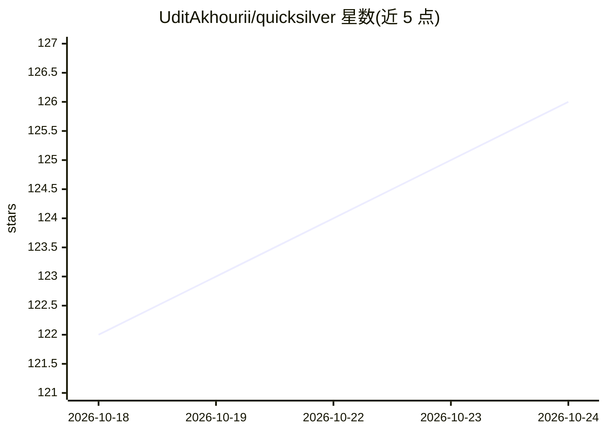

# UditAkhourii/quicksilver

⭐ 126 · JavaScript · MIT · 推送 2026-09-25 · [GitHub](https://github.com/UditAkhourii/quicksilver) · 个人维护

**Claude Code 技能：把批量判断调用转给 Jev 模型以省 token**

一个安装到 ~/.claude/skills 的 Claude Code skill：把“读大量内容做小判断”的活（文件筛选、日志分诊、工单路由、情感分类）交给 TypeSafe 的 Jev 模型（System One），返回类型化判定（yes/no、标签、分数）与带置信度的候选清单，供 Claude 减少上下文消耗。提供 npx 一键安装器、qs filter/classify 等命令与每运行的回执。需 Node 18+ 与 Jev API key（console.typesafe.ai 获取），无 npm 依赖。作者声明与 Anthropic、TypeSafe 无隶属关系，benchmark 位于 bench/ 可复现。

## 筛选速览

| 维度 | 判定 | 备注 |
|---|---|---|
| AI 角色 | `ai-ecosystem` | LLM/agent 周边工具 |
| 许可风险 | `permissive` | MIT |
| 部署形态 | `library` | 以包/库形式分发 |
| 模型依赖 | — | README 未给出锁定关系 |
| 硬件要求 | — | 无带数字的原话,不猜 |
| 安装摩擦 | `low` | 无编译、无系统依赖或容器化 |
| 成熟度 | — | 结构信号不足 |

## 能力要点

- 把批量判断（过滤/分类/定位）委托给 Jev，返回类型化判定与候选清单
- qs filter / qs classify 命令行接口，输出面向 LLM 阅读（含 ? 边界标记与运行回执）
- npx 一行安装，零 npm 依赖，需 Node 18+ 与 Jev key
- 不发送 .env*、私钥等敏感文件，遵守 .gitignore，跳过二进制与超 2MB 文件

## 适用场景

- 在 Claude Code 中过滤大量文件或日志行，找出相关条目
- 对工单、commit、CI 失败做批量分类路由
- 跨代码库做“X 在哪”式定位，减少上下文占用

## 场景标签

 · 领域:开发者工具/AI agent 基础设施

## 证据(README 行号)

> L16: **Quicksilver** is a Claude Code skill that hands those calls to
> L17: Jev, TypeSafe's System One model. Jev returns typed
> L34: The installer copies the skill into `~/.claude/skills/quicksilver` and asks for

## 星数曲线

2026-10-18 122 → 2026-10-24 126（+4）

---
*卡片 v1 · prompt 1.4 · 生成 2026-10-23 · 置信度 high · 依据 README sha `dc77c83aba21` · [字段定义](../../DATASET.md)*
