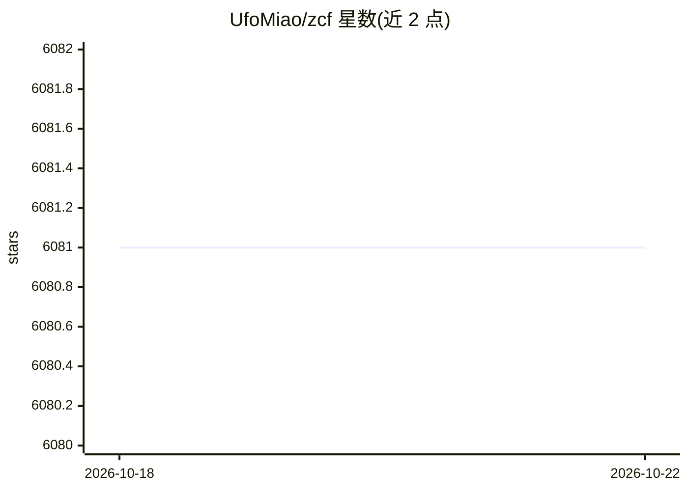

# UfoMiao/zcf

⭐ 6,079 · TypeScript · MIT · 推送 2026-08-31 · [GitHub](https://github.com/UfoMiao/zcf) · [官网](http://zcf.ufomiao.com/) · 个人维护 · 中文 README

**为开发者零配置初始化 Claude Code 与 Codex 的 CLI 工具**

ZCF（Zero-Config Code Flow）是 npm 分发的命令行工具，面向使用 Claude Code 与 Codex 的开发者：通过 npx 交互式菜单完成安装、workflows、API/CCR 与 MCP 的初始化与更新，支持中英日多语言界面切换，也支持非交互式带预设 provider 与 key 的一次性初始化。README 本体仅含快速开始、赞助商与社区信息，详细用法外链至 zcf.ufomiao.com 文档站。项目致谢中提及整合了 CCR、ccusage、BMad Method 等社区工作。

## 筛选速览

| 维度 | 判定 | 备注 |
|---|---|---|
| AI 角色 | `ai-ecosystem` | LLM/agent 周边工具 |
| 许可风险 | `permissive` | MIT |
| 部署形态 | `library` | 以包/库形式分发 |
| 模型依赖 | — | README 未给出锁定关系 |
| 硬件要求 | — | 无带数字的原话,不猜 |
| 安装摩擦 | `low` | 无编译、无系统依赖或容器化 |
| 成熟度 | — | 结构信号不足 |

## 能力要点

- npx zcf i 一键完成安装 + workflows + API/CCR + MCP 初始化
- 交互式菜单与非交互式（预设 provider/key）两种模式
- 多语言界面切换（--lang zh-CN 等）

## 适用场景

- 快速完成 Claude Code 或 Codex 的初始配置
- 更新已有工作流配置
- 用脚本方式带 API key 批量初始化环境

## 场景标签

 · 领域:开发者工具/AI 编程

## 证据(README 行号)

> L17: > Zero-config, one-click setup for Claude Code & Codex with bilingual support, intelligent agent system and persona
> L25: npx zcf i        # Full initialization: install + workflows + API/CCR + MCP

## 星数曲线

2026-10-18 6,081 → 2026-10-22 6,081（+0）

---
*卡片 v1 · prompt 1.4 · 生成 2026-10-20 · 置信度 high · 依据 README sha `18f44c097a09` · [字段定义](../../DATASET.md)*
