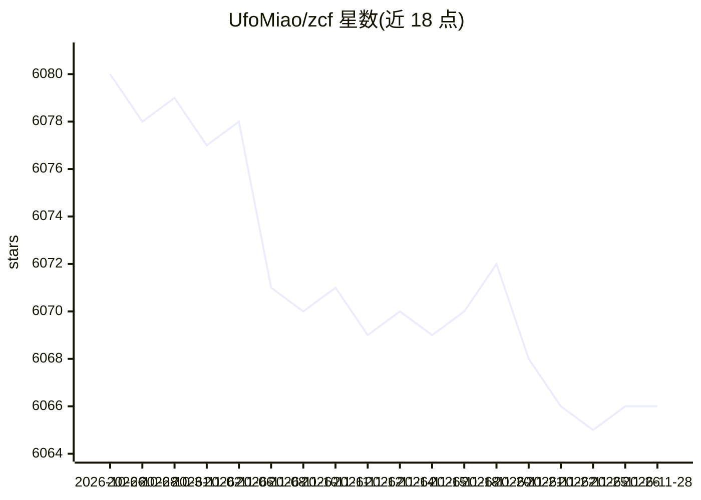

# UfoMiao/zcf

⭐ 6,066 · TypeScript · MIT · 推送 2026-11-21 · [GitHub](https://github.com/UfoMiao/zcf) · [官网](http://zcf.ufomiao.com/) · 个人维护 · 中文 README

**为 Claude Code/Codex 等 AI 编码工具做统一配置安装的 CLI**

ZCF 是一个零配置 CLI 工具：用户维护一份 ZCF 配置（provider、MCP 服务器、skills），ZCF 据此安装用户选择的 AI 编码工具，并调用各工具自身的命令（如 `claude mcp add-json`、`npx skills add`）写入各自配置文件。提供 plan/diff 预览、仅编辑其管理的键、保留注释与格式、修改前备份、不回显密钥等机制。注意：当前 v5 为尚未发布的重写版，`npx zcf` 暂安装 v3。MIT 许可，支持终端与浏览器两种配置方式。

## 筛选速览

| 维度 | 判定 | 备注 |
|---|---|---|
| AI 角色 | `ai-ecosystem` | LLM/agent 周边工具 |
| 许可风险 | `permissive` | MIT |
| 部署形态 | `library` | 以包/库形式分发 |
| 模型依赖 | — | README 未给出锁定关系 |
| 硬件要求 | — | 无带数字的原话,不猜 |
| 安装摩擦 | `low` | 无编译、无系统依赖或容器化 |
| 成熟度 | `idea` | |

## 能力要点

- 一份配置管理多个 AI 编码工具（Claude Code、Codex、Cursor CLI 等 7 个）
- plan/diff 预览机制：apply 前不改动任何文件
- 只编辑自管键、保留注释格式、修改前逐文件备份
- 提供终端与浏览器（zcf ui）两种配置入口

## 适用场景

- 同时使用多个 AI 编码工具时统一管理 provider 与 MCP 配置
- 新机器上一键安装并写入所选工具的配置
- 更新已安装工具时调用各工具自带更新器

## 场景标签

 · 领域:开发者工具/AI 编码工具配置管理

## 证据(README 行号)

> L17: > One config for all your AI coding tools. ZCF installs the tools you pick and writes each one's own settings.
> L26: Supported tools: Claude Code, Codex, Antigravity CLI, OpenCode, Cursor CLI, Pi and DeepSeek Harness.

## 星数曲线

2026-10-26 6,080 → 2026-11-28 6,066（-14）

---
*卡片 v1 · prompt 1.4 · 生成 2026-11-22 · 置信度 high · 依据 README sha `ad87c78d8d28` · [字段定义](../../DATASET.md)*
