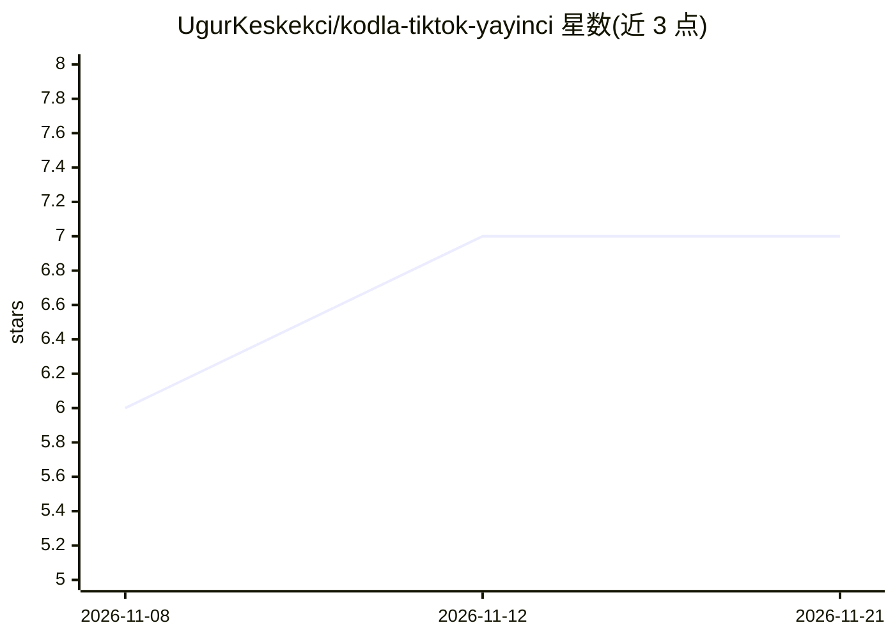

# UgurKeskekci/kodla-tiktok-yayinci

⭐ 7 · HTML · MIT · 推送 2026-11-07 · [GitHub](https://github.com/UgurKeskekci/kodla-tiktok-yayinci) · 个人维护

**TikTok 直播角色：代码逐帧绘制 Canvas 角色，可语音回复评论**

一个用于直播的虚拟角色项目：角色、史莱姆、房间、手部全部以单个 HTML 文件内的 Canvas 代码绘制，无图像生成模型与视频模型。提供角色自定义菜单（发型、肤色、眼睛、服装、声音）、动作按钮、多引擎语音合成（浏览器语音、Edge TTS、VoxCPM2、ElevenLabs），可选接入 TikTok 直播接收评论、礼物与关注并由角色回应。推荐通过 Claude Code 安装，也可用 Node.js 手动安装；无 API key 时评论回复功能不生效。

## 筛选速览

| 维度 | 判定 | 备注 |
|---|---|---|
| AI 角色 | `ai-enhanced` | 去掉 AI 部分产品仍成立 |
| 许可风险 | `permissive` | MIT |
| 部署形态 | `library` | 以包/库形式分发 |
| 模型依赖 | — | README 未给出锁定关系 |
| 硬件要求 | — | 无带数字的原话,不猜 |
| 安装摩擦 | `low` | 无编译、无系统依赖或容器化 |
| 成熟度 | — | 结构信号不足 |

## 能力要点

- 全部画面由 Canvas 代码绘制，无视觉/视频模型
- 四种语音引擎可选，含本地运行的 VoxCPM2 土耳其语语音
- 可选连接 TikTok 直播，评论/礼物/关注驱动角色交互
- 可用 Claude Code 安装并迭代修改角色

## 适用场景

- 以虚拟角色进行 TikTok 直播
- 观众评论触发角色的语音回应与动作
- 离线演示模式（demo=1）下试玩角色与语音

## 场景标签

`语音合成` · 领域:内容生成

## 证据(README 行号)

> L5: Slime yoğuran, yorumlara sesli cevap veren, **her karesi kodla çizilmiş** bir yayın karakteri. Görsel model yok, vid
> L81: Panelde yayın açıkken kullanıcı adınızı yazıp "Bağlan" deyin: yorumlar, hediyeler ve takipler karaktere gelir.
> L74: 4. Hiçbiri yoksa cevap vermez; teşekkürler ve yorum komutları yine çalışır.

## 星数曲线

2026-11-08 6 → 2026-11-21 7（+1）

---
*卡片 v1 · prompt 1.4 · 生成 2026-11-20 · 置信度 mid · 依据 README sha `2d9d01788ee5` · [字段定义](../../DATASET.md)*
