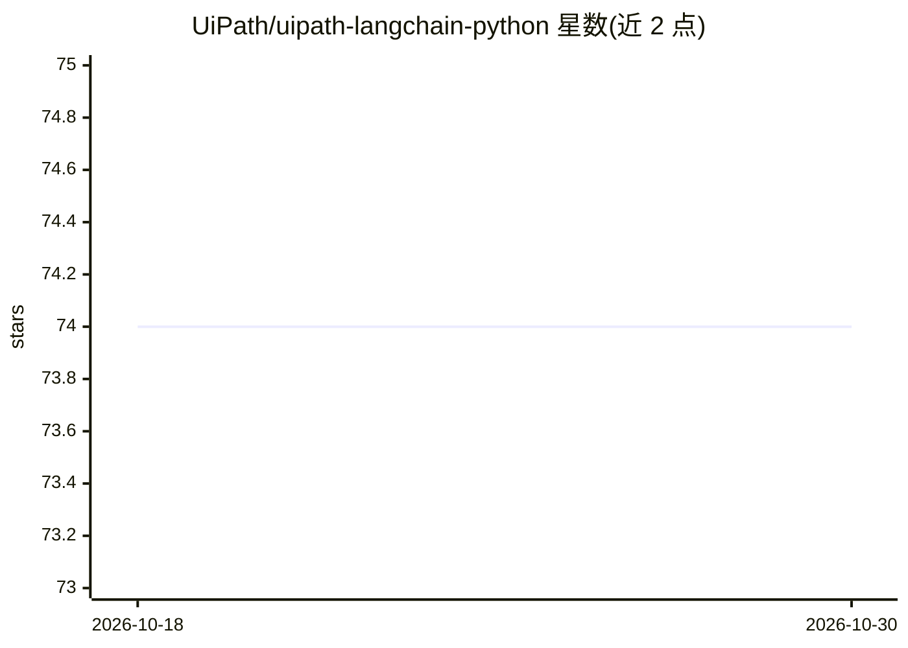

# UiPath/uipath-langchain-python

⭐ 74 · Python · MIT · 推送 2026-10-29 · [GitHub](https://github.com/UiPath/uipath-langchain-python) · [官网](https://uipath.github.io/uipath-python/langchain/quick_start/) · 组织维护

**将 LangGraph agent 构建部署到 UiPath 云平台的 Python SDK**

UiPath 官方 Python SDK，作为 UiPath Python SDK 的扩展，实现 UiPath Runtime Protocol，供开发者以编程方式与 UiPath Cloud Platform 交互，并在其上部署 LangGraph agent；通过 Action Center 集成提供 human-in-the-loop 语义。附带 CLI 覆盖项目全流程：uipath init 生成 entry-points.json/bindings.json、auth 浏览器认证、run 本地调试、pack 打包为 .nupkg、publish 发布至 Orchestrator。要求 Python 3.11+ 与 UiPath Automation Cloud 账户，以 .env 配置 URL 与访问令牌。

## 筛选速览

| 维度 | 判定 | 备注 |
|---|---|---|
| AI 角色 | `ai-ecosystem` | LLM/agent 周边工具 |
| 许可风险 | `permissive` | MIT |
| 部署形态 | `library` | 以包/库形式分发 |
| 模型依赖 | — | README 未给出锁定关系 |
| 硬件要求 | — | 无带数字的原话,不猜 |
| 安装摩擦 | `low` | 无编译、无系统依赖或容器化 |
| 成熟度 | — | 结构信号不足 |

## 能力要点

- 实现 UiPath Runtime Protocol，部署 LangGraph agent 至 UiPath Cloud Platform
- CLI 覆盖 init/auth/run/pack/publish 全流程
- Action Center 集成提供 human-in-the-loop（HITL）语义

## 适用场景

- 把已有的 LangGraph agent 打包发布到 UiPath 云平台运行
- 本地调试 agent 后通过 CLI 完成打包与发布
- 企业自动化流程中引入带人工审批环节的 agent

## 场景标签

 · 领域:企业自动化/LLM 基础设施

## 证据(README 行号)

> L7: A Python SDK that enables developers to build and deploy LangGraph agents to the UiPath Cloud Platform. It provides 
> L9: This package is an extension to the UiPath Python SDK and implements the UiPath Runtime Protocol.

## 星数曲线

2026-10-18 74 → 2026-10-30 74（+0）

---
*卡片 v1 · prompt 1.4 · 生成 2026-10-24 · 置信度 high · 依据 README sha `ab50c9d5ff85` · [字段定义](../../DATASET.md)*
