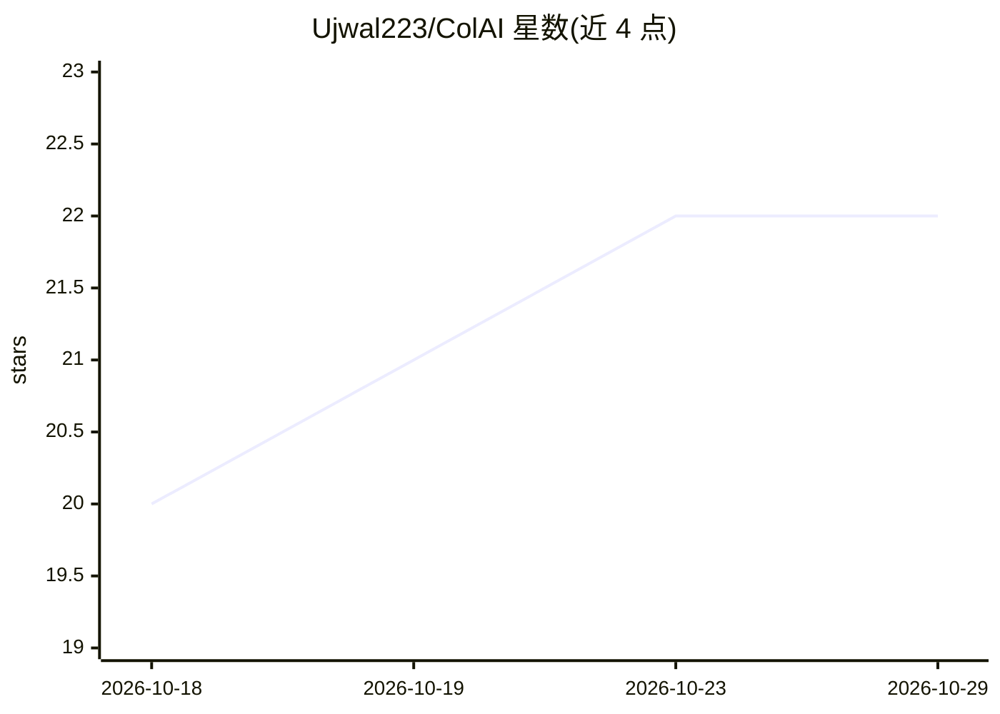

# Ujwal223/ColAI

⭐ 22 · Kotlin · Apache-2.0 · 推送 2026-10-28 · [GitHub](https://github.com/Ujwal223/ColAI) · 个人维护

**Android 多账号 AI 工作区：并行隔离运行多家 AI 网页账号**

开源 Android 应用，用 GeckoView 隔离容器（contextId）同时运行 ChatGPT、Claude、Gemini、DeepSeek、Grok、Perplexity 的多个独立账号，按会话分割 Cookie、存储与缓存，避免跨账号跟踪与反复登录。提供 PIN/生物识别锁、PBKDF2 主恢复密钥、AES-256-GCM 加密备份，可添加自定义网页 AI 服务，含主屏小组件。基于 Jetpack Compose 构建，需 Android 8.0+，从源码编译运行。

## 筛选速览

| 维度 | 判定 | 备注 |
|---|---|---|
| AI 角色 | `ai-ecosystem` | LLM/agent 周边工具 |
| 许可风险 | `permissive` | Apache-2.0 |
| 部署形态 | `None` |  |
| 模型依赖 | locked-api |  |
| 硬件要求 | — | 无带数字的原话,不猜 |
| 安装摩擦 | `medium` | 含编译或系统依赖之一 |
| 成熟度 | — | 结构信号不足 |

## 能力要点

- GeckoView contextId 按会话隔离 Cookie/存储/缓存，支持多账号并行
- PIN/生物识别锁与 AES-256-GCM 加密备份
- 可添加自定义 AI 平台或内部 LLM 端点，内置六个预设
- 主屏小组件支持语音听写与深链直入账号会话

## 适用场景

- 在同一手机上并行管理工作与个人的多个 AI 平台账号
- 为不同账号保持独立会话数据、单独清除某一账号
- 把内部 LLM 端点或自选网页 AI 服务加入统一入口

## 场景标签

`AI 助手` · 领域:对话与助手

## 证据(README 行号)

> L7: An open-source Android workspace built to run multiple independent accounts on ChatGPT, Claude, Gemini, DeepSeek, Gr
> L20: Each account runs inside an isolated **Mozilla GeckoView container** (`contextId`). Cookies, local storage, cache, 

## 星数曲线

2026-10-18 20 → 2026-10-29 22（+2）

---
*卡片 v1 · prompt 1.4 · 生成 2026-10-27 · 置信度 high · 依据 README sha `6f4eb7b1cd9e` · [字段定义](../../DATASET.md)*
