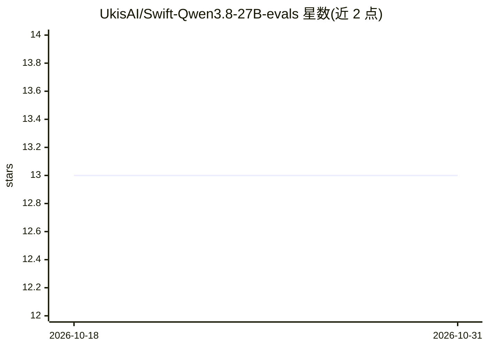

# UkisAI/Swift-Qwen3.8-27B-evals

⭐ 13 · Python · 推送 2026-09-13 · [GitHub](https://github.com/UkisAI/Swift-Qwen3.8-27B-evals) · [官网](https://huggingface.co/ukisai/Swift-Qwen3.8-27b) · 组织维护

**Swift-Qwen3.8-27B 模型评测原始日志数据集**

存放 Swift-Qwen3.8-27B（Qwen3.8-27B BF16 基座 + Swift LoRA 适配器）与 BF16 基座在 9 个基准上的评测原始产物，包括每次采样的完整回复、评分、配置与运行日志，均按产出原样保存。覆盖 GPQA-Diamond、MMLU-Pro、C-Eval、IFBench、AIME 2026、HMMT、ERQA、Terminal-Bench 2.1、LiveCodeBench v6，多数基准跑 5 个随机种子。面向需要核查或复现模型卡评测结果的研究者与开发者。限制：两个超出 GitHub 大小上限的 Terminal-Bench 文件被省略。

## 筛选速览

| 维度 | 判定 | 备注 |
|---|---|---|
| AI 角色 | `ai-knowledge` | 知识聚合/清单类 |
| 许可风险 | `none` | — |
| 部署形态 | `None` |  |
| 模型依赖 | — | README 未给出锁定关系 |
| 硬件要求 | — | 无带数字的原话,不猜 |
| 安装摩擦 | `low` | 无编译、无系统依赖或容器化 |
| 成熟度 | — | 结构信号不足 |

## 能力要点

- 9 个基准的全部逐样本回复与评分
- base 与 swift（LoRA 适配器）两组对照日志
- 多数基准含 5 个种子，配置与运行日志随附

## 适用场景

- 核查 Swift-Qwen3.8-27B 模型卡上的评测结果
- 复用原始回复数据做进一步分析
- 对比 LoRA 适配器与 BF16 基座的逐样本差异

## 场景标签

`模型评测` · 领域:评测与运维

## 证据(README 行号)

> L3: Raw artifacts for the nine benchmarks on the Swift-Qwen3.8-27B model card: Qwen3.8-27B BF16 base vs base + Swift ada
> L7: |01-gpqa-diamond|GPQA-Diamond (198 x 5 seeds)|

## 星数曲线

2026-10-18 13 → 2026-10-31 13（+0）

---
*卡片 v1 · prompt 1.4 · 生成 2026-10-31 · 置信度 high · 依据 README sha `3d93403e92fe` · [字段定义](../../DATASET.md)*
