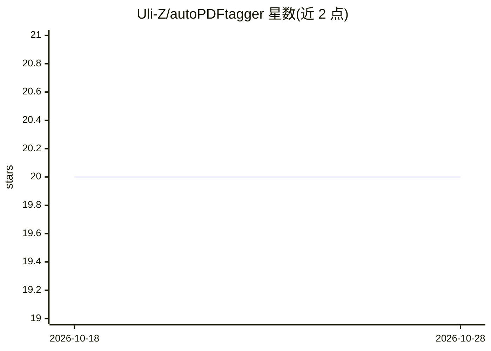

# Uli-Z/autoPDFtagger

⭐ 20 · Python · GPL-3.0 · 推送 2025-11-05 · [GitHub](https://github.com/Uli-Z/autoPDFtagger) · 个人维护 · 中文 README

**为家庭/办公 PDF 档案做 AI 分类、打标与元数据整理的 CLI 工具**

Python 命令行工具，对 PDF 文件（含低质量扫描与图片密集型文档）做半自动分类、排序与打标：用 Tesseract OCR 提取文本，再调用 AI 模型做文本与视觉分析，检测标题、摘要、作者、日期与标签，写入标准 PDF 元数据并可按元数据重命名导出；归档保持普通文件与文件夹，无专有数据库锁定，可导出 JSON/CSV 审查。通过 LiteLLM 支持多模型提供方（测试于 OpenAI，本地 LLM 原则上可用），提供逐字段置信度（0-10）防止覆盖优质元数据、24 小时磁盘缓存与成本报告、并行执行。需 Python 3.9+ 与 Tesseract；云端模型需 API key，云提供方会接收文档内容。GPL-3 许可，项目自述为功能可用但仍在测试、提示词优化与文档改进中。

## 筛选速览

| 维度 | 判定 | 备注 |
|---|---|---|
| AI 角色 | `ai-native` | 本体是模型或模型工具 |
| 许可风险 | `viral` | GPL-3.0 |
| 部署形态 | `library` | 以包/库形式分发 |
| 模型依赖 | — | README 未给出锁定关系 |
| 硬件要求 | — | 无带数字的原话,不猜 |
| 安装摩擦 | `low` | 无编译、无系统依赖或容器化 |
| 成熟度 | — | 结构信号不足 |

## 能力要点

- OCR（Tesseract）+ AI 文本与视觉分析，处理低质量扫描与图片密集 PDF
- 写入标准 PDF 元数据（标题/摘要/作者/标签/日期）并可按元数据重命名导出
- 逐字段置信度（0-10）逻辑：仅在新结果不低于现有置信度时更新
- LiteLLM 多模型接入，24h 磁盘缓存与成本报告，并行执行

## 适用场景

- 整理家庭或办公室的 PDF 档案，自动打标签和重命名文件
- 处理扫描件和图片型 PDF（如演示文稿），提取标题作者等元数据
- 导出 JSON/CSV 数据库对档案元数据进行审查和批量编辑

## 场景标签

`OCR` `文档解析` · 领域:知识与检索

## 证据(README 行号)

> L18: autoPDFtagger is a CLI for semi‑automatic classification, sorting, and tagging of PDF documents. It enriches PDFs w
> L42: - OCR (via Tesseract) + AI text analysis

## 星数曲线

2026-10-18 20 → 2026-10-28 20（+0）

---
*卡片 v1 · prompt 1.4 · 生成 2026-10-28 · 置信度 mid · 依据 README sha `d919066a9e09` · [字段定义](../../DATASET.md)*
