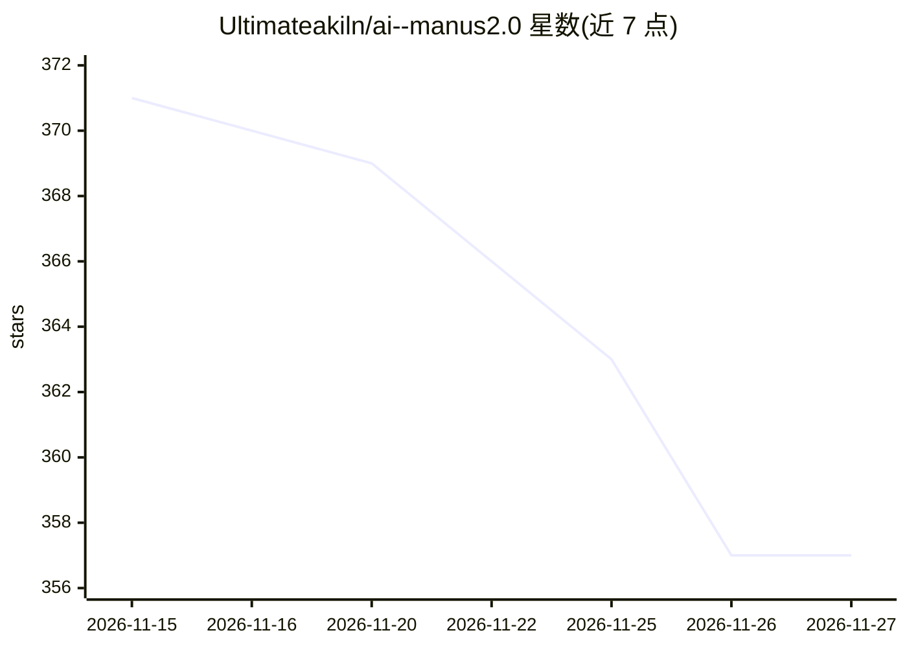

# Ultimateakiln/ai--manus2.0

⭐ 357 · Apache-2.0 · 推送 2026-11-15 · [GitHub](https://github.com/Ultimateakiln/ai--manus2.0) · 个人维护

**面向个人用户的自主 AI Agent：代写执行代码并控制浏览器**

README 以宣传文案形式介绍名为 Manus 的自主 AI agent：据描述可在沙箱环境中运行代码、控制浏览器（导航网页、填表、采集信息）并执行多步骤任务，定位为家庭、学习与轻量办公场景的个人助手。但 README 未给出任何安装命令、源码结构、所依赖的模型或 API 接入方式，仅提供功能描述、硬件兼容表和启动步骤的文字说明，可验证的技术事实有限。

## 筛选速览

| 维度 | 判定 | 备注 |
|---|---|---|
| AI 角色 | `ai-native` | 本体是模型或模型工具 |
| 许可风险 | `permissive` | Apache-2.0 |
| 部署形态 | `None` |  |
| 模型依赖 | — | README 未给出锁定关系 |
| 硬件要求 | — | 无带数字的原话,不猜 |
| 安装摩擦 | `low` | 无编译、无系统依赖或容器化 |
| 成熟度 | — | 结构信号不足 |

## 能力要点

- 自主执行代码与浏览器操作（导航、填表、信息采集）
- 支持多步骤任务，可在脚本与浏览器操作之间衔接
- 面向家庭、学习与轻量办公的小规模任务场景

## 适用场景

- 让学生整理研究笔记、运行小脚本
- 让 agent 汇总多个网页的信息用于轻量报告
- 把重复性的网页检查、文件整理等杂务交给后台 agent

## 场景标签

`AI 助手` `编码 Agent` `浏览器自动化` · 领域:效率与自动化

## 证据(README 行号)

> L10: - **Autonomous Code Execution:** Manus AI agent runs code on its own to complete tasks, so you can focus on decisio
> L18: Manus is an autonomous AI agent designed to run code and control a browser on your behalf. Instead of acting like a

## 星数曲线

2026-11-15 371 → 2026-11-27 357（-14）

---
*卡片 v1 · prompt 1.4 · 生成 2026-11-17 · 置信度 low · 依据 README sha `71798a5b9c2b` · [字段定义](../../DATASET.md)*
