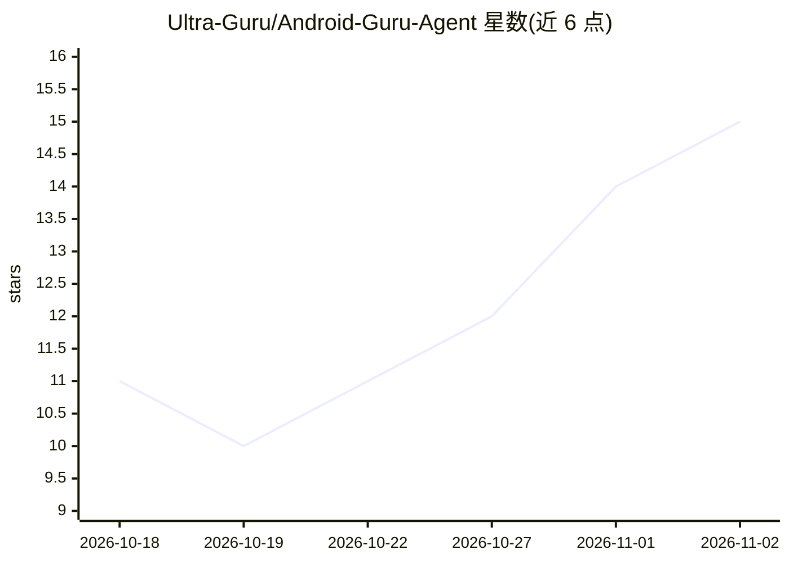

# Ultra-Guru/Android-Guru-Agent

⭐ 15 · Kotlin · NOASSERTION · 推送 2026-11-01 · [GitHub](https://github.com/Ultra-Guru/Android-Guru-Agent) · [官网](https://ultra-guru.github.io/Android-Guru-Agent/) · 个人维护 · 中文 README

**完全运行在 Android 手机上的 AI 编码智能体应用**

Kotlin/Compose 编写的 Android 端 AI 编码工作台：OpenAI 兼容流式 LLM 接入（BYO-LLM，支持局域网 Ollama、DeepSeek、OpenRouter 等端点），内置百余工具、PRoot 沙箱 Ubuntu 24.04 终端、仿生认知记忆系统（差分摄取→轨迹蒸馏→FSM 宏旁路回放）、Root/Shizuku/无障碍三级权限链与插件 SDK。Agent 引擎提供 ReAct 直连与任务编排双路径、六种工作模式与七档思考深度。全部功能在单机运行，无需服务器或 PC；APK 从 Release 仓库下载，本仓库专注 Coding，聊天模式拆分至 Theocracy 仓库。许可为 UGRL v1.0 restricted。

## 筛选速览

| 维度 | 判定 | 备注 |
|---|---|---|
| AI 角色 | `ai-native` | 本体是模型或模型工具 |
| 许可风险 | `none` | NOASSERTION |
| 部署形态 | `None` |  |
| 模型依赖 | local-ok | 支持本地模型 |
| 硬件要求 | — | 无带数字的原话,不猜 |
| 安装摩擦 | `medium` | 含编译或系统依赖之一 |
| 成熟度 | — | 结构信号不足 |

## 能力要点

- PRoot 用户态沙箱运行 Ubuntu 24.04，apt install 可用
- BYO-LLM：任意 OpenAI 兼容端点 / 局域网 Ollama 多模型角色路由
- 百级内置工具 + 八层执行硬化 + MCP/技能按工位作用域隔离
- 仿生认知记忆：程序性宏技能指纹命中可 0 token 旁路回放

## 适用场景

- 在手机上完成编码任务：文件编辑、git、终端与浏览器自动化
- 无 Root 设备经 Shizuku/沙箱三级降级执行特权命令
- 通过多模型路由让图片自动走 VISION 模型、编码走推理模型

## 场景标签

`编码 Agent` · 领域:编码与开发

## 证据(README 行号)

> L9: **An AI coding workstation that lives entirely on your Android device.**
> L15: 全部跑在一台手机上，无需任何服务器。（Agent 聊天模式已拆分至独立仓库 Theocracy，本仓库专注 Coding。）

## 星数曲线

2026-10-18 11 → 2026-11-02 15（+4）

---
*卡片 v1 · prompt 1.4 · 生成 2026-10-31 · 置信度 high · 依据 README sha `4fbebb6e526b` · [字段定义](../../DATASET.md)*
