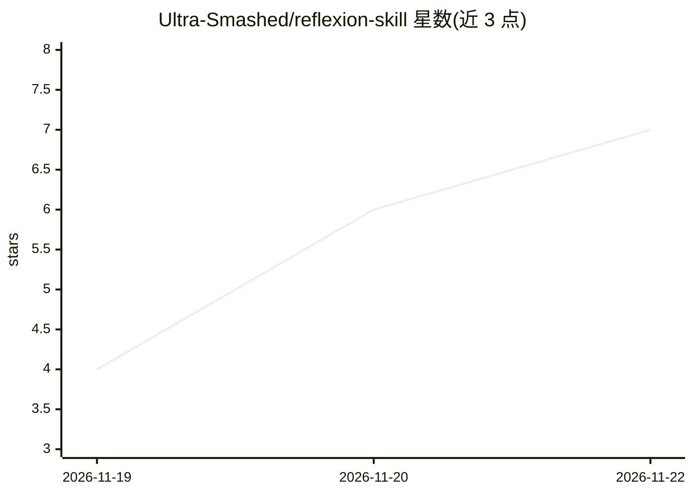

# Ultra-Smashed/reflexion-skill

⭐ 7 · Python · MIT · 推送 2026-11-16 · [GitHub](https://github.com/Ultra-Smashed/reflexion-skill) · [官网](https://thanisch.co/wissen/guides/reflexion-skill) · 个人维护 · 中文 README

**给 Claude 用户的任务复盘 Skill：四问总结并把经验写入文件**

以 Claude Skill/插件形式提供的任务复盘工具：输入 /reflexion 后按 After Action Review 的四个问题回顾刚结束的会话，产出可执行的教训；经用户批准后可修改 CLAUDE.md、AGENTS.md、Cursor 规则或 SKILL.md，并将每条教训写入 LESSONS.md 日志。带去重检查（词干化与相似度阈值 40%/70%）、三态状态标记（notiert/vorgeschlagen/angewendet），支持 --global 全局日志。需 Python 3.8+，无第三方包；效果从下一次会话开始。

## 筛选速览

| 维度 | 判定 | 备注 |
|---|---|---|
| AI 角色 | `ai-ecosystem` | LLM/agent 周边工具 |
| 许可风险 | `permissive` | MIT |
| 部署形态 | `None` |  |
| 模型依赖 | — | README 未给出锁定关系 |
| 硬件要求 | — | 无带数字的原话,不猜 |
| 安装摩擦 | `low` | 无编译、无系统依赖或容器化 |
| 成熟度 | — | 结构信号不足 |

## 能力要点

- 四问式 After Action Review 复盘流程，生成下一会话可遵循的教训
- LESSONS.md 日志与去重检查（40% 提示、70% 拒写、--trotzdem 覆盖）
- 经批准后自动更新 CLAUDE.md/AGENTS.md/SKILL.md 等配置文件
- Python CLI（lessons.py）可独立执行查重与追加

## 适用场景

- 每次任务结束后让 AI Agent 复盘并沉淀经验
- 团队维护项目级 LESSONS.md 避免重复教训
- 让下一会话自动读取既往教训改进行为

## 场景标签

`Agent 记忆` · 领域:Agent 开发

## 证据(README 行号)

> L3: Ein Claude-Skill für die Nachbesprechung nach jeder Aufgabe. Du tippst `/reflexion`, und der Agent schaut auf die Si
> L28: Oder als Plugin in Claude Code:
> L82: Der Skill trainiert kein Modell. Er schreibt Text in Dateien, die der Agent beim nächsten Start liest. Die Wirkung 

## 星数曲线

2026-11-19 4 → 2026-11-22 7（+3）

---
*卡片 v1 · prompt 1.4 · 生成 2026-11-20 · 置信度 high · 依据 README sha `046e3bf9d61c` · [字段定义](../../DATASET.md)*
