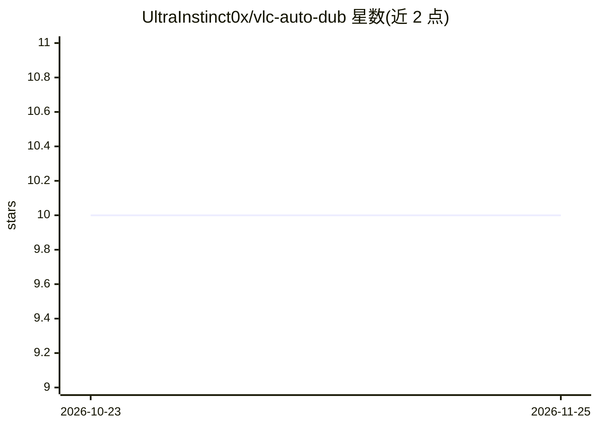

# UltraInstinct0x/vlc-auto-dub

⭐ 10 · Python · MIT · 推送 2026-10-12 · [GitHub](https://github.com/UltraInstinct0x/vlc-auto-dub) · 个人维护

**VLC 扩展：本地为视频生成翻译配音音轨与字幕**

以 Python CLI 为核心、VLC Lua 扩展为入口的视频配音管线：提取音频→faster-whisper 转写（词级时间戳）→可选 argostranslate/NLLB 翻译→piper/espeak-ng 合成语音→按时长槽位对齐→封装为新音轨，同时输出 SRT 字幕。默认全本地运行、无 API key、无遥测；`--in-place` 以原子替换方式将音轨/字幕写入原文件并保留全部原始轨道。AudioSet 分类器可在字幕中标注笑声、音乐等声音标签。默认假设单说话人，无说话人分离。

## 筛选速览

| 维度 | 判定 | 备注 |
|---|---|---|
| AI 角色 | `ai-native` | 本体是模型或模型工具 |
| 许可风险 | `permissive` | MIT |
| 部署形态 | `self-host` | docker 或自建部署 |
| 模型依赖 | — | README 未给出锁定关系 |
| 硬件要求 | — | 无带数字的原话,不猜 |
| 安装摩擦 | `low` | 无编译、无系统依赖或容器化 |
| 成熟度 | — | 结构信号不足 |

## 能力要点

- 转写+翻译+TTS+对齐+封装的端到端本地配音管线
- --in-place 原子替换，保留全部原始轨道且失败不损原文件
- STT/TTS/翻译均为可插拔 provider（含 fake 测试替身）
- Apple Silicon 经 mlx-whisper 走 GPU，其余走 CPU

## 适用场景

- 给视频生成另一语言的配音音轨与字幕
- 仅为视频批量转写生成 SRT 字幕
- 离线环境处理视频语音，不上传媒体文件

## 场景标签

`语音合成` `语音识别` · 领域:内容生成

## 证据(README 行号)

> L7: Dubs a video file end to end: extract audio → transcribe (STT) → **optional
> L13: Everything runs locally. The default path is **fully local and

## 星数曲线

2026-10-23 10 → 2026-11-25 10（+0）

---
*卡片 v1 · prompt 1.4 · 生成 2026-11-20 · 置信度 mid · 依据 README sha `2f9c377b4098` · [字段定义](../../DATASET.md)*
