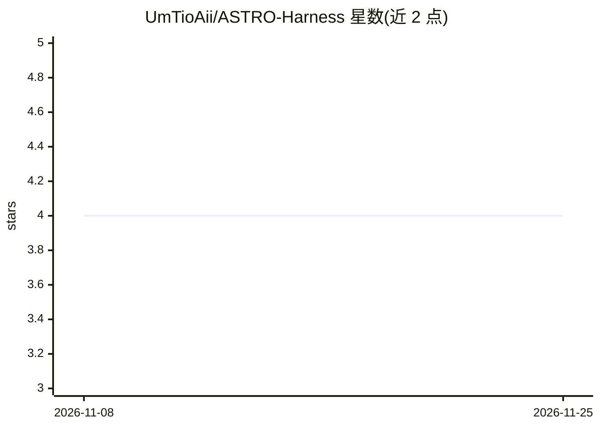

# UmTioAii/ASTRO-Harness

⭐ 4 · TypeScript · MIT · 推送 2026-11-24 · [GitHub](https://github.com/UmTioAii/ASTRO-Harness) · 个人维护

**本地终端优先的多 agent 编码 harness：路由、审计、成本治理**

运行于本地的终端优先 harness，为 AI 编码 agent 提供会话管理：每次请求成为在声明范围内规划、读写并执行代码的会话，附带 append-only 账本、逐步模型调用成本计量、预算上限与权限审批（ask/allow-edits/bypass 模式加固定保护底线）。通过 TUIX 交互界面或行式 REPL 运行，支持 TUIX 内零配置接入 provider 或环境变量临时 provider。定位对象为对真实仓库运行编码 agent、需要了解变更内容与成本的开发者和团队。本地运行，无托管服务、账户与遥测。

## 筛选速览

| 维度 | 判定 | 备注 |
|---|---|---|
| AI 角色 | `ai-ecosystem` | LLM/agent 周边工具 |
| 许可风险 | `permissive` | MIT |
| 部署形态 | `library` | 以包/库形式分发 |
| 模型依赖 | local-ok | 支持本地模型 |
| 硬件要求 | — | 无带数字的原话,不猜 |
| 安装摩擦 | `low` | 无编译、无系统依赖或容器化 |
| 成熟度 | — | 结构信号不足 |

## 能力要点

- append-only 账本与审计日志记录每步模型、成本与决策
- 确定性模型路由：角色固定模型、共享 provider 池，运行时子 agent 只能在配置池内选择
- 成本治理：按日/月/项目的美元预算、警告阈值与硬上限
- 权限审批 fail-closed，含 Docker 沙箱执行 run_command

## 适用场景

- 对真实仓库运行编码 agent 并审计每次写入与成本
- 团队为不同角色固定模型并复用共享 provider 池
- 评估不同模型或提示词（eval/bench 共用同一 harness）
- 无遥测的本地离线使用场景

## 场景标签

`编码 Agent` `多智能体` `模型网关` `LLM 可观测性` · 领域:Agent 开发

## 证据(README 行号)

> L3: ASTRO is a local, terminal-first harness for AI coding agents. Every request becomes a session that plans, reads, wr
> L5: It runs on your machine, against the providers you choose, and it is built for the questions that show up after the 
> L10: - Teams that want a fixed model per role, a shared provider pool, and a reviewable record of every decision.

## 星数曲线

2026-11-08 4 → 2026-11-25 4（+0）

---
*卡片 v1 · prompt 1.4 · 生成 2026-11-21 · 置信度 high · 依据 README sha `75a075d1bb35` · [字段定义](../../DATASET.md)*
