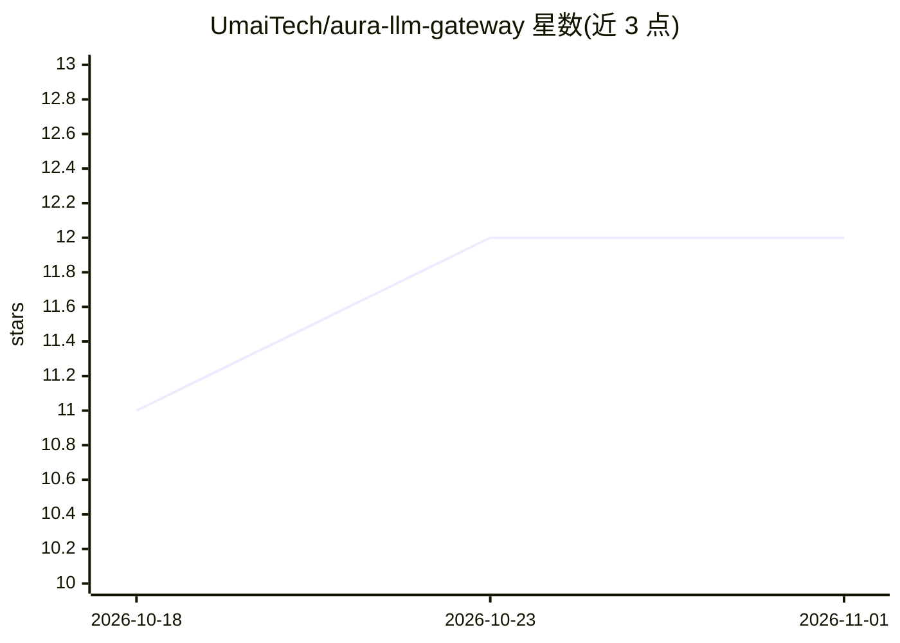

# UmaiTech/aura-llm-gateway

⭐ 12 · Rust · MIT · 推送 2026-10-23 · [GitHub](https://github.com/UmaiTech/aura-llm-gateway) · [官网](https://aura-llm.dev) · 组织维护

**Rust 实现的 LLM 网关：统一 Open Responses API 接入多家提供商**

用 Rust（Axum/Tokio）编写的 LLM 代理网关，实现 Open Responses API 规范，面向 agentic 工作流：将 OpenAI、Anthropic、Google、Mistral、Together AI、Fireworks AI、Ollama、HuggingFace TGI、AWS Bedrock 共 9 家提供商统一在一个接口后，提供智能路由与故障转移（8 种策略）、按请求美元成本追踪、提示压缩、AES-256-GCM 凭证加密、多租户 API key 层级与 Redis 响应缓存。提供 Python/TypeScript SDK、Docker 与 Helm 部署。README 声明为 pre-1.0 软件，API、数据库 schema 与配置格式可能在 0.x 版本间变更。

## 筛选速览

| 维度 | 判定 | 备注 |
|---|---|---|
| AI 角色 | `ai-ecosystem` | LLM/agent 周边工具 |
| 许可风险 | `permissive` | MIT |
| 部署形态 | `self-host` | docker 或自建部署 |
| 模型依赖 | local-ok | 支持本地模型 |
| 硬件要求 | — | 无带数字的原话,不猜 |
| 安装摩擦 | `low` | 无编译、无系统依赖或容器化 |
| 成熟度 | `idea` | |

## 能力要点

- 9 家 LLM 提供商统一到一个 Open Responses API 契约
- 8 种智能路由策略 + 熔断器与故障转移
- 按请求美元成本追踪，含输入/输出/缓存/推理 token 细分
- 组织→团队→项目→终端用户的多租户与作用域 API key

## 适用场景

- 自托管统一网关，让 agentic 应用跨多家 LLM 提供商工作
- 对 LLM 流量做成本追踪、限流与按 key 预算控制
- 通过 auto 路由与故障转移保障生产 LLM 调用可靠性

## 场景标签

`模型网关` · 领域:Agent 开发

## 证据(README 行号)

> L30: A high-performance LLM proxy gateway built in Rust that implements the Open Responses API specification for agentic
> L89: Aura LLM Gateway provides a unified interface to multiple LLM providers (OpenAI, Anthropic, Google, Mistral, Togeth
> L114: - **9 LLM providers** behind one Open Responses API — OpenAI, Anthropic (Claude), Google (Gemini), Mistral, Togeth

## 星数曲线

2026-10-18 11 → 2026-11-01 12（+1）

---
*卡片 v1 · prompt 1.4 · 生成 2026-11-01 · 置信度 high · 依据 README sha `738b05964937` · [字段定义](../../DATASET.md)*
