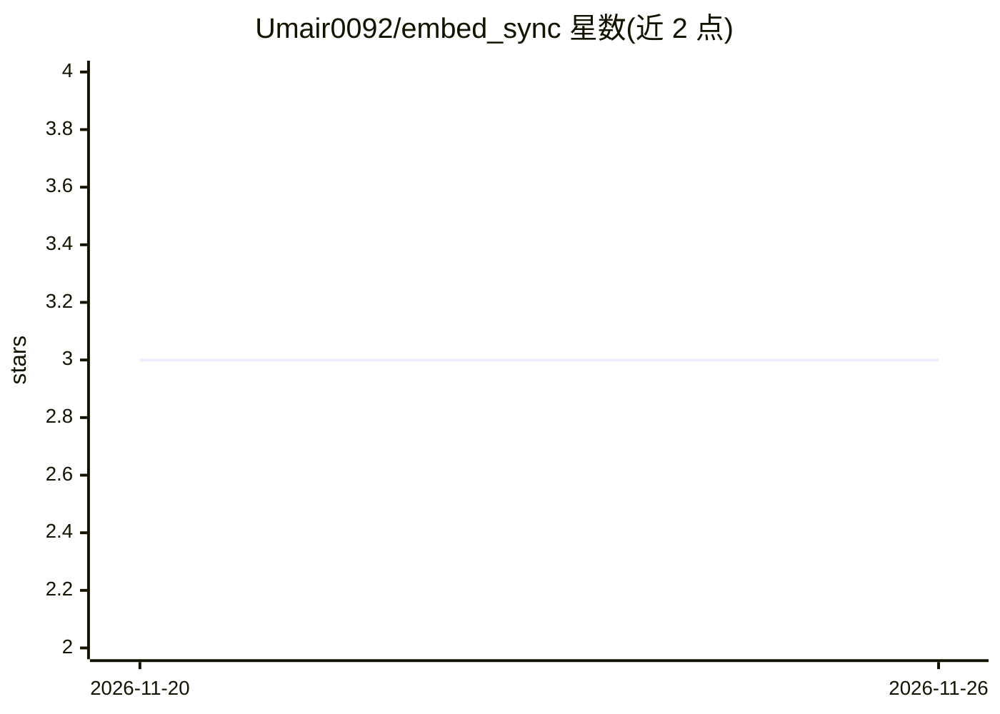

# Umair0092/embed_sync

⭐ 3 · Ruby · MIT · 推送 2026-11-11 · [GitHub](https://github.com/Umair0092/embed_sync) · [官网](https://rubygems.org/gems/embed_sync) · 个人维护

**Rails 向量嵌入同步库：模型数据变更时自动更新 pgvector**

面向 Rails 应用的 Ruby gem，连接 neighbor（向量检索）与 ruby_llm（嵌入生成）：记录文本变更时通过后台任务重新生成嵌入，用文本摘要跳过未变更的保存以避免重复 API 调用，支持分批回填既有表、切换嵌入模型后自动重嵌入，并提供一行式语义搜索方法。要求 Ruby 3.2+、Rails 7.1+、PostgreSQL 与 pgvector。同步模式支持 Active Job 异步、inline 及关闭，测试可用离线 :fake 提供者。

## 筛选速览

| 维度 | 判定 | 备注 |
|---|---|---|
| AI 角色 | `ai-ecosystem` | LLM/agent 周边工具 |
| 许可风险 | `permissive` | MIT |
| 部署形态 | `None` |  |
| 模型依赖 | — | README 未给出锁定关系 |
| 硬件要求 | — | 无带数字的原话,不猜 |
| 安装摩擦 | `low` | 无编译、无系统依赖或容器化 |
| 成熟度 | — | 结构信号不足 |

## 能力要点

- 基于文本 digest 的变更检测，未变更保存不调用 API
- 分批、可安全重跑的 backfill，支持限流与并发上限配置
- 切换嵌入模型或维度后自动标记旧行并重新嵌入
- 支持自定义 provider（任何含 #embed 方法的对象）

## 适用场景

- Rails 应用中让 pgvector 嵌入随 ActiveRecord 记录编辑保持最新
- 为既有表批量回填嵌入而不阻塞部署
- 更换嵌入模型后批量重嵌入受影响数据
- 在 RAG 应用中维护语义搜索的向量列

## 场景标签

`RAG` `语义搜索` · 领域:知识与检索

## 证据(README 行号)

> L6: > Keep vector embeddings in sync with your ActiveRecord models.
> L25: Use EmbedSync if your Rails app stores embeddings in Postgres (pgvector) for semantic search or RAG, and you're wri
> L32: It's not a vector database client or an LLM framework: it keeps one thing correct, the vectors in your own tables.

## 星数曲线

2026-11-20 3 → 2026-11-26 3（+0）

---
*卡片 v1 · prompt 1.4 · 生成 2026-11-22 · 置信度 high · 依据 README sha `b8402f955cf7` · [字段定义](../../DATASET.md)*
