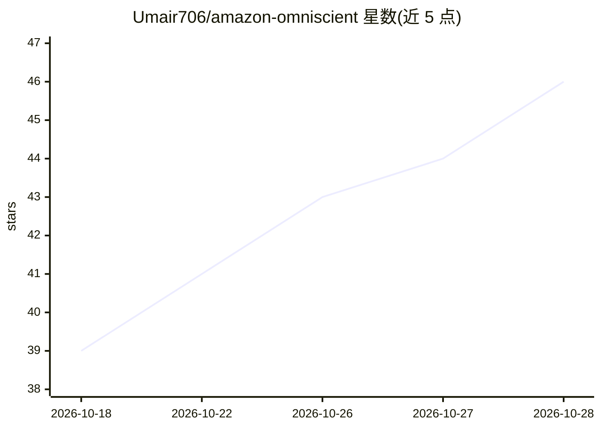

# Umair706/amazon-omniscient

⭐ 46 · Python · NOASSERTION · 推送 2026-10-03 · [GitHub](https://github.com/Umair706/amazon-omniscient) · 个人维护

**自托管的 Amazon FBA 选品研究引擎：选品评分与利润测算**

面向 Amazon FBA 卖家与自有品牌卖家的全栈自托管选品研究工具，由 FastAPI 后端与 Next.js 14 前端组成。功能包括：Playwright 抓取 Amazon 商品/评论/BSR 数据（可配置 SP-API 凭据优先）、抓取 Made-in-China.com 供应商报价、按 9 项加权子分与 9 项硬性淘汰规则计算 0-100 选品评分、到岸成本与 FBA 费用计算、52 周牛/基准/熊三情景财务预测。AI 部分为可配置 LLM（Qwen 默认、Claude、GPT 或本地 Ollama），用于评论情感、痛点聚类与产品蓝图生成；另提供 MCP 服务器供 Claude Desktop/Cursor 等 agent 调用。README 自称 Helium 10/Jungle Scout/AMZScout 的替代方案。Docker Compose 一键部署，自备 API 凭据。

## 筛选速览

| 维度 | 判定 | 备注 |
|---|---|---|
| AI 角色 | `ai-enhanced` | 去掉 AI 部分产品仍成立 |
| 许可风险 | `none` | NOASSERTION |
| 部署形态 | `self-host` | docker 或自建部署 |
| 模型依赖 | local-ok | 支持本地模型 |
| 硬件要求 | — | 无带数字的原话,不猜 |
| 安装摩擦 | `low` | 无编译、无系统依赖或容器化 |
| 成熟度 | — | 结构信号不足 |

## 能力要点

- 9 项加权子分 + 9 项硬性淘汰规则的 0-100 选品评分
- 到岸成本计算（FOB/关税/301 关税/FBA 费用）与 52 周三情景财务预测
- LLM 可配置：Qwen 默认、Claude、GPT 或本地 Ollama
- MCP 服务器供 Claude Desktop/Cursor 等 agent 作为工具箱调用

## 适用场景

- 自托管选品分析，避免订阅 SaaS 工具的月费
- 对利基市场做竞争分析与利润/到岸成本测算
- 让 Claude 等 AI agent 通过 MCP 调用选品数据生成商业计划

## 场景标签

`网页抓取` `数据分析` · 领域:效率与自动化

## 证据(README 行号)

> L20: 7. **Runs LLM-powered analysis** for review sentiment, pain point clustering, product spec generation, and competit
> L55: |LLM|Configurable: Qwen (default), Anthropic Claude, OpenAI GPT, or a free local model via Ollama|
> L27: 14. **Serves an MCP toolbox** — an LLM agent (Claude Desktop, etc.) can connect to Omniscient over MCP and use it a

## 星数曲线

2026-10-18 39 → 2026-10-28 46（+7）

---
*卡片 v1 · prompt 1.4 · 生成 2026-10-25 · 置信度 high · 依据 README sha `67f4b9a1c877` · [字段定义](../../DATASET.md)*
