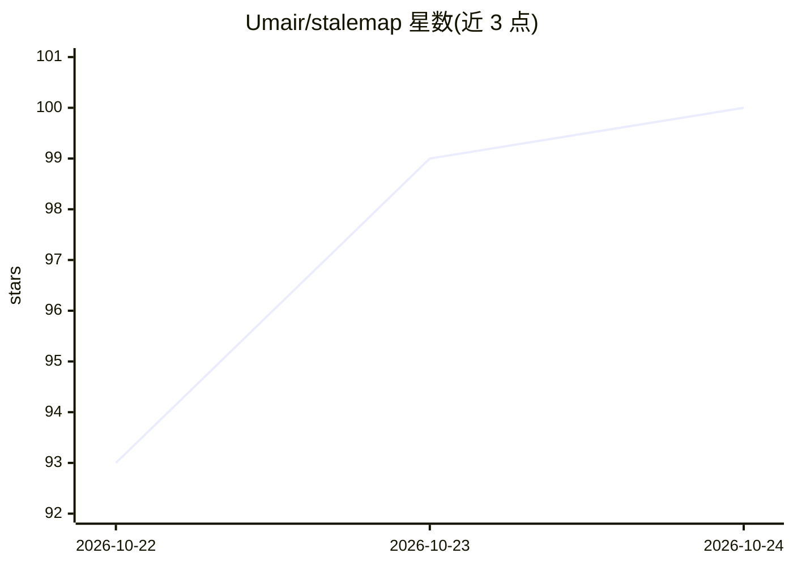

# Umair/stalemap

⭐ 100 · TypeScript · MIT · 推送 2026-10-21 · [GitHub](https://github.com/Umair/stalemap) · [官网](https://stalemap.com) · 个人维护

**告知编码代理依赖在训练截止后变化的工具，写入 AGENTS.md**

面向 JavaScript/TypeScript 项目的命令行与 MCP 工具：读取项目锁定的依赖版本与模型训练截止日期（来自 models.dev 或 --cutoff），用 TypeScript 编译器 API 对比两版 .d.ts、扫描变更日志与升级指南，将排序后的变更摘要写入 AGENTS.md/CLAUDE.md（默认 1,800 token 预算）。另提供编辑后守卫（运行项目 tsc 并匹配说明）、search_changes MCP 检索工具、Claude Code 插件与 GitHub Action。支持 Claude Code、Cursor、Codex、OpenCode 及任意 MCP 客户端；由单人维护，自述项目尚处早期，Cursor/Codex/OpenCode 路径未在真实安装中验证。

## 筛选速览

| 维度 | 判定 | 备注 |
|---|---|---|
| AI 角色 | `ai-ecosystem` | LLM/agent 周边工具 |
| 许可风险 | `permissive` | MIT |
| 部署形态 | `library` | 以包/库形式分发 |
| 模型依赖 | — | README 未给出锁定关系 |
| 硬件要求 | — | 无带数字的原话,不猜 |
| 安装摩擦 | `low` | 无编译、无系统依赖或容器化 |
| 成熟度 | `idea` | |

## 能力要点

- diff 两版 .d.ts 类型并聚合变更日志，生成按项目实际使用排序的变更块
- 编辑后守卫：运行项目自身 tsc 并附匹配的修复说明
- MCP 工具 search_changes 以 BM25 检索依赖变更
- 一条命令 setup --agent 为 Cursor/Codex/OpenCode/Claude 写入笔记、注册 MCP 与守卫钩子

## 适用场景

- 项目锁定版本新于模型训练截止时，让编码代理预知 API 变更
- 在 CI 中检测变更块缺失或过期并拦截
- 在 PR 中评论依赖相对模型认知的变化

## 场景标签

 · 领域:开发者工具/AI 编码代理

## 证据(README 行号)

> L18: stalemap finds the dependencies that changed after your model's training cutoff and tells the agent what changed, i
> L24: It works for JavaScript and TypeScript projects, with Claude Code, Cursor, Codex, OpenCode or any MCP client.

## 星数曲线

2026-10-22 93 → 2026-10-24 100（+7）

---
*卡片 v1 · prompt 1.4 · 生成 2026-10-23 · 置信度 high · 依据 README sha `ecf2f9209424` · [字段定义](../../DATASET.md)*
