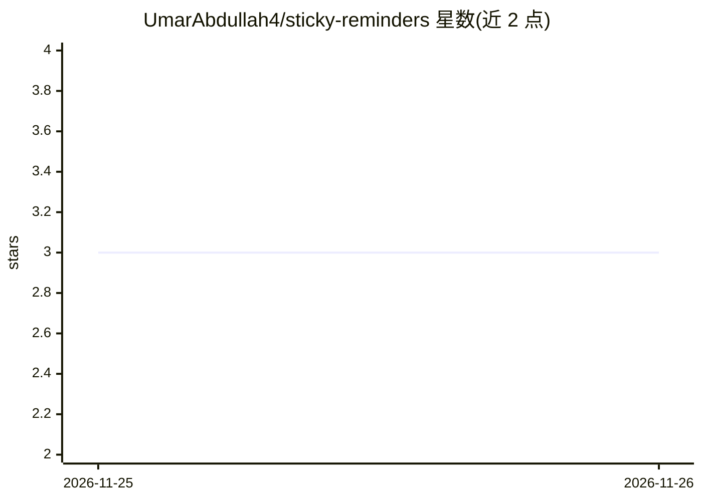

# UmarAbdullah4/sticky-reminders

⭐ 3 · Python · MIT · 推送 2026-11-23 · [GitHub](https://github.com/UmarAbdullah4/sticky-reminders) · 个人维护

**Windows 桌面便签与提醒应用，可选 AI 助手**

单文件 Python 的 Windows 便签/提醒应用：彩色便签支持富文本、任务进度（百分比或阶段）、重复截止日期、系统托盘常驻与提醒弹窗。通过连接器把 Mattermost、Slack、Discord、Telegram 消息转为便签，标记完成后在原线程回复。可选 AI 助手在设置中启用后，可建议便签、总结线程背景、规划任务阶段与步骤、整理笔记结构，并读取笔记指定的文件/文件夹作为上下文。数据提供原子保存、每日备份与 Markdown/JSON 导出，凭据经 Windows DPAPI 加密。提供安装包、便携版或源码运行三种方式。

## 筛选速览

| 维度 | 判定 | 备注 |
|---|---|---|
| AI 角色 | `ai-enhanced` | 去掉 AI 部分产品仍成立 |
| 许可风险 | `permissive` | MIT |
| 部署形态 | `desktop` | 安装包/桌面程序 |
| 模型依赖 | local-ok | 支持本地模型 |
| 硬件要求 | — | 无带数字的原话,不猜 |
| 安装摩擦 | `low` | 无编译、无系统依赖或容器化 |
| 成熟度 | — | 结构信号不足 |

## 能力要点

- Mattermost/Slack/Discord/Telegram 消息可转为便签并回帖
- AI 助手支持 Claude、OpenAI、Gemini 及任意 OpenAI 兼容端点
- 任务规划、笔记结构化与上下文文件读取（每请求 40,000 字符上限）
- 原子保存、每日备份（保留 14 份）与 JSON/Markdown 导出

## 适用场景

- 把聊天里 @ 到我的请求一键变成待办便签
- 给手机发 Telegram 消息快速记录事项
- 用几句话让 AI 把任务拆成阶段和步骤
- 团队内跨人互发提醒并在原线程确认完成

## 场景标签

`AI 助手` `知识库管理` · 领域:对话与助手

## 证据(README 行号)

> L7: A desktop sticky-notes and reminder app for Windows. Install it like any other
> L56: **Assistant (optional)**
> L215: Off until you choose a provider in **Settings → AI**. Enter a key, pick a model

## 星数曲线

2026-11-25 3 → 2026-11-26 3（+0）

---
*卡片 v1 · prompt 1.4 · 生成 2026-11-24 · 置信度 mid · 依据 README sha `9cf5387d51e6` · [字段定义](../../DATASET.md)*
