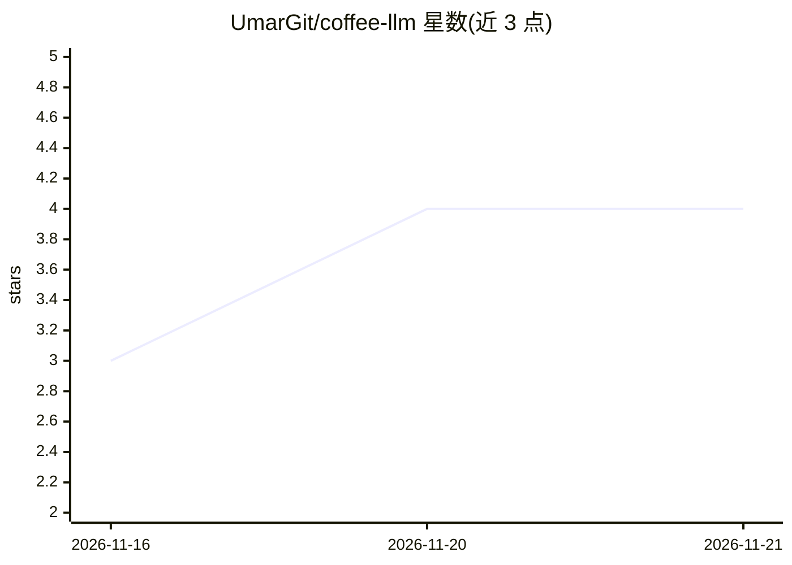

# UmarGit/coffee-llm

⭐ 4 · Python · 推送 2026-11-12 · [GitHub](https://github.com/UmarGit/coffee-llm) · [官网](https://umargit.github.io/coffee-llm/) · 组织维护

**研究小型模型输出格式以降低点单解析静默错误的论文与系统**

ITMO 大学 IDM 实验室的论文配套仓库：在 PIZZA 语义解析基准上以 LoRA 微调 Qwen3.5-0.8B，对同一目标树的六种无损编码做 36 次运行对比，提出以静默错误率（解析合法但不正确）为评估目标，结论为自然词构成的输出格式以约 3.8 倍更少 token 达到与原生 s-expression 相当的精确匹配。附带产出的咖啡点单解析器：俄语/英语语音转写转成紧凑订单字符串，经 Ollama 部署，并发布 Q8_0 GGUF 用于 iPad 离线运行。论文源文件在 paper/，协议在 PROTOCOL.md。

## 筛选速览

| 维度 | 判定 | 备注 |
|---|---|---|
| AI 角色 | `ai-native` | 本体是模型或模型工具 |
| 许可风险 | `none` | — |
| 部署形态 | `None` |  |
| 模型依赖 | local-ok | 支持本地模型 |
| 硬件要求 | — | 无带数字的原话,不猜 |
| 安装摩擦 | `low` | 无编译、无系统依赖或容器化 |
| 成熟度 | — | 结构信号不足 |

## 能力要点

- 六种输出编码、36 次运行、1,357 条测试语句的系统对比
- 以静默错误率（parse validity − exact match）为核心指标
- 咖啡点单解析器在 Apple M1 上经 Ollama 每单中位延迟约 80 ms，可在 iPad 离线运行
- 训练数据生成器可精确复现 4,000 条训练样本

## 适用场景

- 为小模型结构化输出选择 token 高效且低静默错误的编码格式
- 语音点单转紧凑订单字符串的离线解析
- 复现论文的编码格式对比实验

## 场景标签

`微调` · 领域:训练与推理

## 证据(README 行号)

> L20: format** can be designed to reduce that risk, and ships the café ordering system that came
> L75: The café parser is the finding applied: a fine-tune of Qwen3.5-0.8B that turns a spoken
> L77: output tokens per order.

## 星数曲线

2026-11-16 3 → 2026-11-21 4（+1）

---
*卡片 v1 · prompt 1.4 · 生成 2026-11-21 · 置信度 high · 依据 README sha `6a91c8a18649` · [字段定义](../../DATASET.md)*
