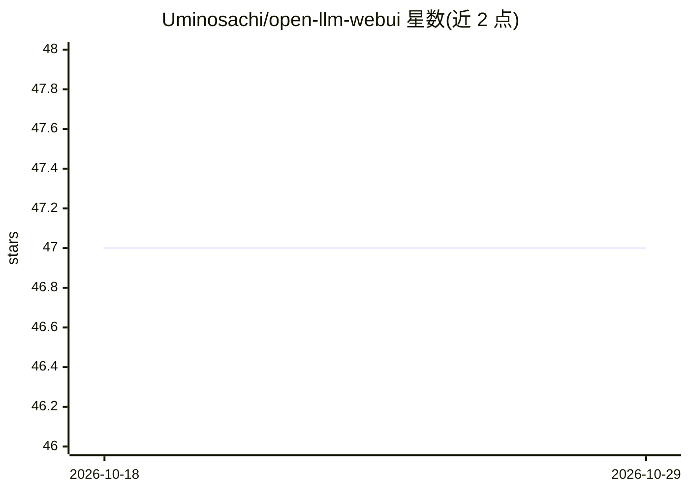

# Uminosachi/open-llm-webui

⭐ 47 · Python · Apache-2.0 · 推送 2026-02-08 · [GitHub](https://github.com/Uminosachi/open-llm-webui) · 个人维护

**本地运行小型 LLM 的 Gradio Web 聊天界面**

面向终端用户的 Web 应用，在本地执行较小型的大语言模型：通过 transformers（含 4/8-bit 量化）、llama.cpp（GGUF 文件）与 LLaVA（多模态图像问答）三种后端加载模型，在浏览器中进行对话，可调节温度、Top k/p 等参数，支持从 Hugging Face 直接下载模型、批量处理多个 prompt 文件，并提供日英自动互译选项。安装基于 conda + pip，可选 CUDA/Metal 加速，Mac 上 LLaVA 存在已知报错问题。

## 筛选速览

| 维度 | 判定 | 备注 |
|---|---|---|
| AI 角色 | `ai-native` | 本体是模型或模型工具 |
| 许可风险 | `permissive` | Apache-2.0 |
| 部署形态 | `library` | 以包/库形式分发 |
| 模型依赖 | local-ok | 支持本地模型 |
| 硬件要求 | — | 无带数字的原话,不猜 |
| 安装摩擦 | `high` | 编译与系统依赖俱全 |
| 成熟度 | — | 结构信号不足 |

## 能力要点

- 支持 transformers、llama.cpp（GGUF）、LLaVA 多模态三种模型后端
- Web UI 内一键从 Hugging Face 下载模型，可自行添加模型路径
- 支持 4-bit/8-bit 量化加载与 Flash Attention、CUDA/Metal 加速
- input_prompts.json 批量连续处理多个提示词，日英自动互译选项

## 适用场景

- 在本机 GPU/CPU 上离线对话使用小型开源 LLM
- 上传图片结合 LLaVA 模型做多模态问答
- 批量跑一组提示词并收集模型输出

## 场景标签

`聊天机器人` `多模态` · 领域:对话与助手

## 证据(README 行号)

> L3: This repository contains a web application designed to execute relatively compact, locally-operated Large Language M
> L240: * Enter your message into the "Input text" box. Adjust the slider for "Max new tokens" as needed.
> L258: * You can upload an image to the LLaVA Image area of this tab and input a prompt related to the image.

## 星数曲线

2026-10-18 47 → 2026-10-29 47（+0）

---
*卡片 v1 · prompt 1.4 · 生成 2026-10-25 · 置信度 high · 依据 README sha `508a33e65c70` · [字段定义](../../DATASET.md)*
