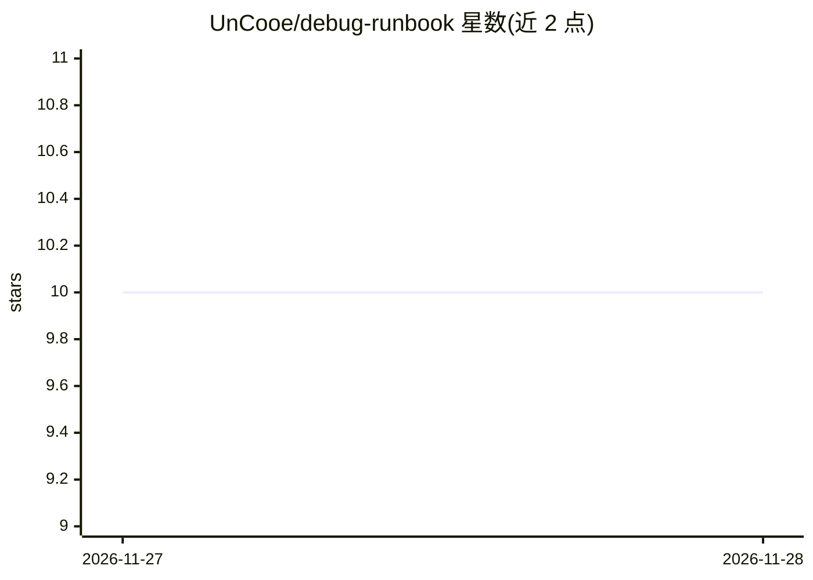

# UnCooe/debug-runbook

⭐ 10 · HTML · MIT · 推送 2026-06-21 · [GitHub](https://github.com/UnCooe/debug-runbook) · 个人维护 · 中文 README

**给 AI Agent 提供 runbook 驱动的后端故障排查证据采集层**

一个 MCP 服务器形式的故障调查工具层：针对后端线上事故，按内置 runbook（证据配方+退出条件）选择匹配的调查路径，按固定顺序调用适配器采集证据（Langfuse、数据库、Redis 等），归一化为结构化结论，输出适用性判定而非根因结论，判断留给持有完整上下文的 agent。所有适配器只读，SQL 防写、表与 key 白名单限制。Node.js ≥18.17 运行，零配置 demo 使用可重放 fixtures，无需 Langfuse/Postgres/Redis 凭据。

## 筛选速览

| 维度 | 判定 | 备注 |
|---|---|---|
| AI 角色 | `ai-ecosystem` | LLM/agent 周边工具 |
| 许可风险 | `permissive` | MIT |
| 部署形态 | `library` | 以包/库形式分发 |
| 模型依赖 | — | README 未给出锁定关系 |
| 硬件要求 | — | 无带数字的原话,不猜 |
| 安装摩擦 | `low` | 无编译、无系统依赖或容器化 |
| 成熟度 | `idea` | |

## 能力要点

- runbook 选择器按信号权重匹配事故模式并选择调查路径
- 证据归一化：工具输出转为紧凑结构化发现而非原始负载
- 决策引擎输出适用性/边界判定，不代替 agent 下根因结论
- 适配器只读：SQL 防写、表与 Redis key 前缀白名单、Langfuse 字段过滤

## 适用场景

- 订单创建后下游任务未生成的线上事故排查
- 缓存状态与持久化不一致时采集结构化证据
- 把 MCP 服务器接入自己的可观测性系统做事故调查

## 场景标签

 · 领域:运维/LLM 基础设施

## 证据(README 行号)

> L3: **Runbook-driven backend incident investigation for AI agents.**
> L48: - An MCP server entrypoint so the investigation flow can be exposed to AI tools.
> L94: ## Connect To Real Systems

## 星数曲线

2026-11-27 10 → 2026-11-28 10（+0）

---
*卡片 v1 · prompt 1.4 · 生成 2026-11-27 · 置信度 mid · 依据 README sha `cfcaea49b164` · [字段定义](../../DATASET.md)*
