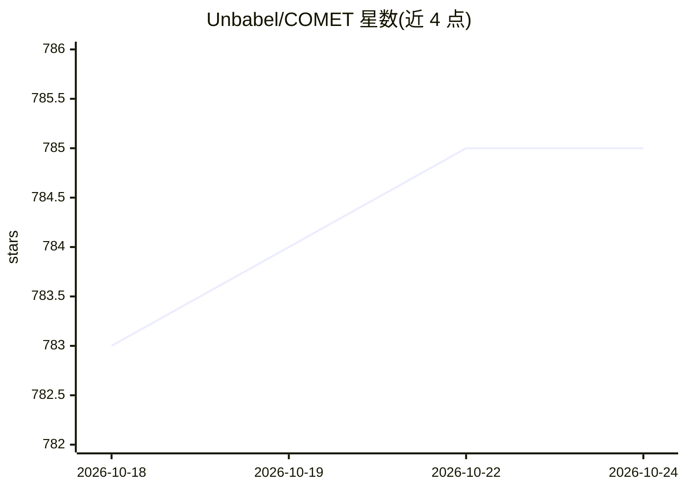

# Unbabel/COMET

⭐ 785 · Python · Apache-2.0 · 推送 2026-04-21 · [GitHub](https://github.com/Unbabel/COMET) · [官网](https://unbabel.github.io/COMET/html/index.html) · 组织维护

**机器翻译质量评测框架：为译文打分并定位错误**

Unbabel 维护的神经 MT 评测框架：基于 XLM-R/InfoXLM 等预训练模型，为机器翻译输出输出 0-1 质量评分，支持有参考与无参考（QE）模式；XCOMET 模型可按 MQM 分类标注 minor/major/critical 错误片段，并可结合 xTower 生成自然语言错误解释。提供 CLI（comet-score/compare/mbr/train）与 Python API，支持多系统统计显著性比较、MBR 译句重排、自有指标训练并上传 Hugging Face Hub。部分模型需在 HF Hub 确认许可后使用，覆盖语言以 XLM-R 支持范围为准。

## 筛选速览

| 维度 | 判定 | 备注 |
|---|---|---|
| AI 角色 | `ai-ecosystem` | LLM/agent 周边工具 |
| 许可风险 | `permissive` | Apache-2.0 |
| 部署形态 | `library` | 以包/库形式分发 |
| 模型依赖 | — | README 未给出锁定关系 |
| 硬件要求 | — | 无带数字的原话,不猜 |
| 安装摩擦 | `low` | 无编译、无系统依赖或容器化 |
| 成熟度 | — | 结构信号不足 |

## 能力要点

- 有参考与无参考（QE）两种评测模式，评分 0-1
- XCOMET 按 MQM 类型标注 minor/major/critical 错误片段并导出 JSON
- comet-compare 提供 Paired T-Test 与 bootstrap 统计显著性比较
- 支持训练自有评测指标并上传 Hugging Face Hub

## 适用场景

- 为机器翻译系统输出自动打分并排名
- 对比多个 MT 系统并做统计显著性检验
- 定位译文中具体错误片段并生成解释
- MBR 解码时用 COMET 指标挑选最优译文

## 场景标签

`模型评测` · 领域:评测与运维

## 证据(README 行号)

> L55: comet-score -s src.txt -t hyp1.txt -r ref.txt
> L105: When comparing multiple MT systems we encourage you to run the `comet-compare` command to get **statistical signif

## 星数曲线

2026-10-18 783 → 2026-10-24 785（+2）

---
*卡片 v1 · prompt 1.4 · 生成 2026-10-21 · 置信度 high · 依据 README sha `d2ab7dc037ff` · [字段定义](../../DATASET.md)*
