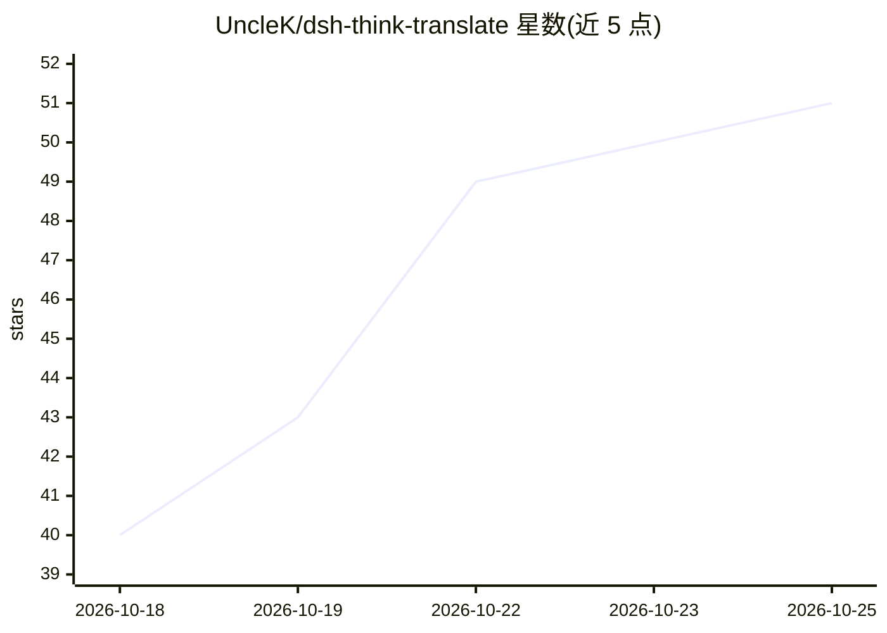

# UncleK/dsh-think-translate

⭐ 51 · JavaScript · MIT · 推送 2026-10-24 · [GitHub](https://github.com/UncleK/dsh-think-translate) · 个人维护

**DeepSeek Harness 网页端的思维链实时翻译插件**

面向 DeepSeek Harness Web UI 的第三方客户端插件：在显示层实时将模型的推理链、任务卡片与回答翻译为 8 种目标语言之一，原文保留在转录中，译文不进入模型上下文。翻译通过可拖拽排序的服务商链完成，内置 google gtx、bing 与本地 Ollama，可添加 OpenAI 兼容/Anthropic 端点，并可自动发现 DSH 配置中已有的服务商。代码行、路径与正则不被翻译。以 dsh plugin 命令安装，需随 DSH 重启生效。

## 筛选速览

| 维度 | 判定 | 备注 |
|---|---|---|
| AI 角色 | `ai-ecosystem` | LLM/agent 周边工具 |
| 许可风险 | `permissive` | MIT |
| 部署形态 | `None` |  |
| 模型依赖 | local-ok | 支持本地模型 |
| 硬件要求 | — | 无带数字的原话,不猜 |
| 安装摩擦 | `low` | 无编译、无系统依赖或容器化 |
| 成熟度 | — | 结构信号不足 |

## 能力要点

- 推理链/任务卡片/回答实时翻译为 8 种语言，仅在显示层、不消耗上下文
- 可拖拽排序的服务商链：google/bing/本地 Ollama/OpenAI 兼容/Anthropic 自定义端点
- 自动发现 DSH profiles 中已配置的服务商，密钥运行时解析不落盘
- 段落与句子感知分块；代码、路径、URL、正则不翻译

## 适用场景

- 观看中文思维链模型时以自己语言阅读推理过程
- 在 Auto review 拒绝卡片上阅读译成目标语言的审查理由
- 用本地 Ollama 模型离线翻译思考链

## 场景标签

 · 领域:LLM 客户端插件/翻译

## 证据(README 行号)

> L11: Translate the **reasoning / thinking chain (chain-of-thought), task cards and answers** of the DeepSeek Harness Web
> L19: - **🔗 Dynamic provider chain** — order providers by drag-and-drop and enable/disable each one. Built-ins (google gt

## 星数曲线

2026-10-18 40 → 2026-10-25 51（+11）

---
*卡片 v1 · prompt 1.4 · 生成 2026-10-24 · 置信度 high · 依据 README sha `4efa531f150b` · [字段定义](../../DATASET.md)*
