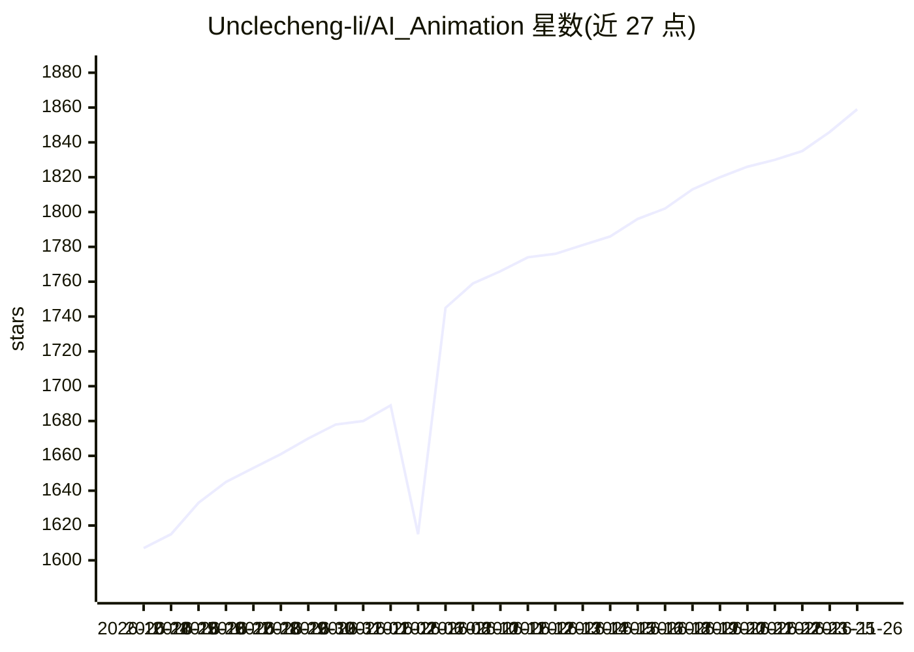

# Unclecheng-li/AI_Animation

⭐ 1,859 · HTML · MIT · 推送 2026-10-26 · [GitHub](https://github.com/Unclecheng-li/AI_Animation) · 个人维护 · 中文 README

**给 AI Agent 用户的一套 HTML 动画生成 Skills 集合**

基于 WorkBuddy / Claude Code / Cursor 等 AI Agent 的动效 Skill 集合，每个 Skill 为自包含文件夹（SKILL.md 指令、README 文档、references 提示词、assets 模板 HTML）。安装后 Agent 依据用户描述自动激活对应 Skill，生成完整的单文件 HTML 动画，覆盖 PPT 演示、流程图、网络协议可视化、动态架构图、手写笔记、卡片剧场、视频分镜、手机 UI 与 Win11 仿真等类别；另含 GSAP 动效镜像库、HTML→MP4 渲染底座与视频 QA 工具。

## 筛选速览

| 维度 | 判定 | 备注 |
|---|---|---|
| AI 角色 | `ai-knowledge` | 知识聚合/清单类 |
| 许可风险 | `permissive` | MIT |
| 部署形态 | `library` | 以包/库形式分发 |
| 模型依赖 | — | README 未给出锁定关系 |
| 硬件要求 | — | 无带数字的原话,不猜 |
| 安装摩擦 | `medium` | 含编译或系统依赖之一 |
| 成熟度 | — | 结构信号不足 |

## 能力要点

- 每个 Skill 自包含 SKILL.md + 模板 HTML，Agent 按描述自动激活
- 覆盖 PPT、流程图、协议可视化、架构图等 17 类动效场景
- dynamic-archify 支持 Mermaid 输入与 PNG/SVG/GIF/WebM 导出
- HyperFrames 底座将 HTML/CSS/动画渲染为确定性 MP4

## 适用场景

- 用 Claude Code 生成可录屏成片的技术科普演示动画
- 为系统设计评审生成带流动动画的架构图
- 制作手机 UI 风格或仿 Win11 的产品演示视频素材

## 场景标签

`提示工程` · 领域:Agent 开发

## 证据(README 行号)

> L14: 本仓库是基于 WorkBuddy / Claude Code / Cursor 等 AI Agent 的**动效 Skill 集合**。每个 Skill 是一个自包含文件夹，包含 `SKILL.md`（Agent 执行指令）、`R
> L7: Skills count

## 星数曲线

2026-10-24 1,607 → 2026-11-26 1,859（+252）

---
*卡片 v1 · prompt 1.4 · 生成 2026-11-24 · 置信度 mid · 依据 README sha `5706d674a06c` · [字段定义](../../DATASET.md)*
