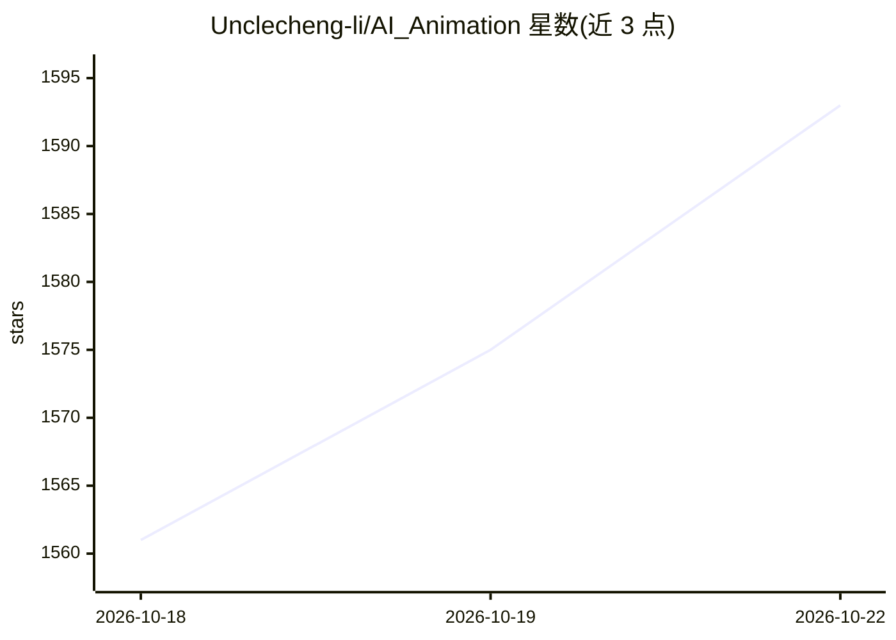

# Unclecheng-li/AI_Animation

⭐ 1,606 · HTML · MIT · 推送 2026-10-20 · [GitHub](https://github.com/Unclecheng-li/AI_Animation) · 个人维护 · 中文 README

**面向 AI Agent 的 HTML 动画生成技能（Skill）集合，含 12 类动效**

基于 WorkBuddy / Claude Code / Cursor 等 AI Agent 的动效 Skill 集合。每个 Skill 为自包含文件夹，含 SKILL.md（Agent 执行指令）、README、references/ 与 assets/ 模板；安装后 AI Agent 依据用户描述自动激活对应 Skill，生成完整单文件 HTML 动画。覆盖 PPT 翻页演示、流程图/原理演示、网络协议可视化、动态架构图（支持 Mermaid 输入与多格式导出）、手写笔记、3D 卡片轮播、视频分镜、手机/Win11 系统 UI 仿真、瑞士风格图表、UI2V 动效库（1,262 个 GSAP 动效包离线镜像）等 12 个技能。产物多为零依赖单文件 HTML，双击离线可跑。

## 筛选速览

| 维度 | 判定 | 备注 |
|---|---|---|
| AI 角色 | `ai-knowledge` | 知识聚合/清单类 |
| 许可风险 | `permissive` | MIT |
| 部署形态 | `library` | 以包/库形式分发 |
| 模型依赖 | — | README 未给出锁定关系 |
| 硬件要求 | — | 无带数字的原话,不猜 |
| 安装摩擦 | `low` | 无编译、无系统依赖或容器化 |
| 成熟度 | — | 结构信号不足 |

## 能力要点

- 每个 Skill 含 SKILL.md 指令 + 参考文档 + 模板 HTML，Agent 据描述自动激活
- 12 类动画技能：PPT 演示、流程图、网络协议可视化、架构图、手机/Win11 UI 仿真等
- 产物为零依赖单文件 HTML，无 CDN、双击离线可运行
- dynamic-archify 支持 Mermaid 输入与 PNG/SVG/GIF/WebM 导出；ui2v-motions 含 1,262 个 GSAP 动效包离线镜像

## 适用场景

- 让 Claude Code / Cursor 等 Agent 一句话生成视频配套的演示动画
- 把技术讲解、网络课程做成动画流程图或协议可视化页面
- 制作手机系统 UI、Win11 仿真等录屏成片用于教程或产品演示

## 场景标签

`提示工程` · 领域:Agent 开发

## 证据(README 行号)

> L14: 本仓库是基于 WorkBuddy / Claude Code / Cursor 等 AI Agent 的**动效 Skill 集合**。每个 Skill 是一个自包含文件夹，包含 `SKILL.md`（Agent 执行指令）、`R
> L3: **一套用 AI 生成炫酷 HTML 动画的 Agent Skills 集合 · A collection of skills for generating cool HTML animations with AI**

## 星数曲线

2026-10-18 1,561 → 2026-10-22 1,593（+32）

---
*卡片 v1 · prompt 1.4 · 生成 2026-10-21 · 置信度 high · 依据 README sha `56aa8a6468c8` · [字段定义](../../DATASET.md)*
