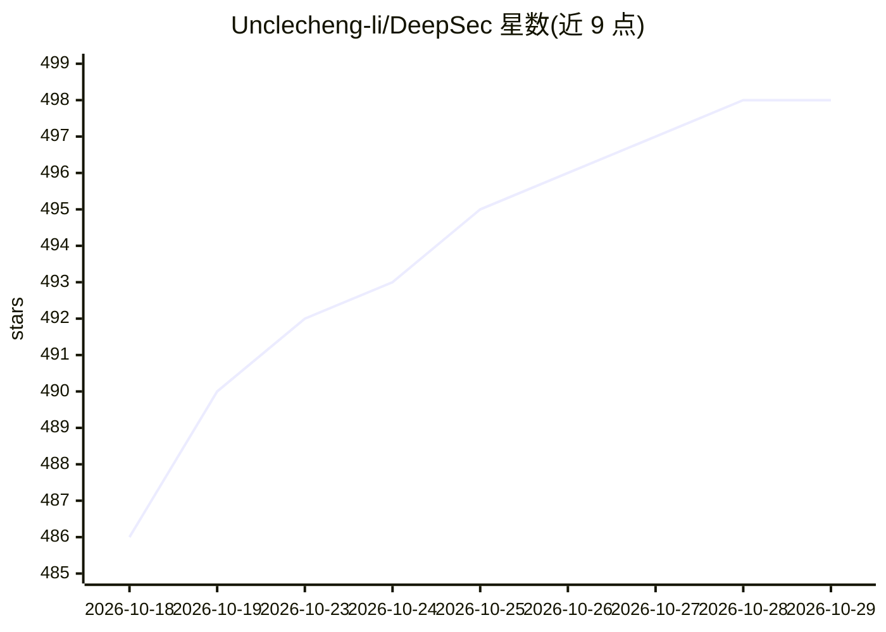

# Unclecheng-li/DeepSec

⭐ 498 · Python · MIT · 推送 2026-08-24 · [GitHub](https://github.com/Unclecheng-li/DeepSec) · [官网](https://unclecheng-li.github.io/deepsec.com/) · 个人维护 · 中文 README

**AI 代码审计与授权渗透测试一体的安全平台**

DeepSec 将 Shield（AI 代码安全审计）与 Spear（授权渗透测试引擎）统一到 CLI、Rust TUI 工作台和 VSCode/JetBrains 插件中。Shield 采用三层检测：L1 正则+熵分析查幻觉包与硬编码密钥，L2 Tree-sitter AST 分析注入类漏洞，L3 调用 13+ 家 LLM 提供商（含本地启发式兜底）查语义漏洞。Spear 提供 40+ 技能包（nmap/nuclei/sqlmap 等）全流程自动化渗透，以授权白名单（scope.json）为强制闸门，默认阻止私有地址。面向开发与安全人员，MIT 许可。

## 筛选速览

| 维度 | 判定 | 备注 |
|---|---|---|
| AI 角色 | `ai-ecosystem` | LLM/agent 周边工具 |
| 许可风险 | `permissive` | MIT |
| 部署形态 | `desktop` | 安装包/桌面程序 |
| 模型依赖 | local-ok | 支持本地模型 |
| 硬件要求 | — | 无带数字的原话,不猜 |
| 安装摩擦 | `low` | 无编译、无系统依赖或容器化 |
| 成熟度 | — | 结构信号不足 |

## 能力要点

- 三层检测架构：正则/AST/LLM 语义分析组合
- Spear 40+ 渗透技能包与 5 种角色，白名单签名授权机制
- Rust + ratatui TUI 工作台，含 Plan/Agent/YOLO 三种模式
- 内置 MCP Server，可被 Claude Desktop、Cursor 调用

## 适用场景

- 审计 AI 生成代码中的幻觉包、硬编码密钥与注入漏洞
- 在授权范围内自动化执行渗透测试并生成 SARIF/HTML 报告
- 在 VSCode/JetBrains 中获得实时安全诊断与 Quick Fix

## 场景标签

`网络安全` `代码审查` · 领域:编码与开发

## 证据(README 行号)

> L37: DeepSec 是由 VibeGuard 进化而来的 AI 安全平台，将 **Shield**（AI 代码安全审计）与 **Spear**（授权渗透测试引擎）统一到一套 CLI、一个 TUI 终端工作台和一组 IDE 插件中。
> L54: |**L3**|缺失认证/限流/校验等语义漏洞|< 5s|LLM（DeepSeek/Claude/OpenAI/Ollama）+ 本地启发式兜底|
> L372: DeepSec 内置 MCP（Model Context Protocol）Server，可被 Claude Desktop、Cursor 等 MCP 客户端调用：

## 星数曲线

2026-10-18 486 → 2026-10-29 498（+12）

---
*卡片 v1 · prompt 1.4 · 生成 2026-10-21 · 置信度 high · 依据 README sha `e11c11283cf1` · [字段定义](../../DATASET.md)*
