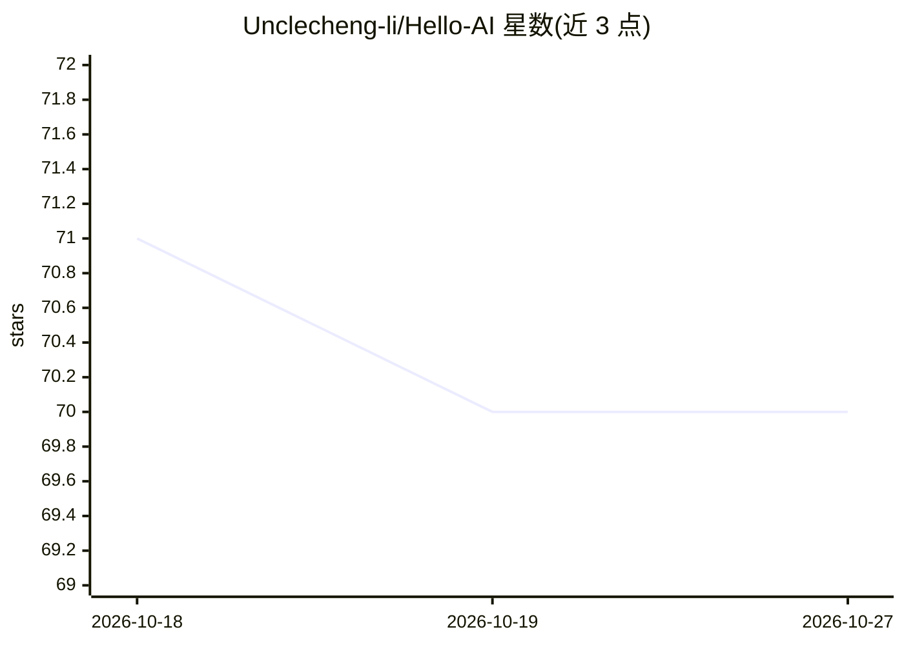

# Unclecheng-li/Hello-AI

⭐ 70 · Python · MIT · 推送 2026-07-27 · [GitHub](https://github.com/Unclecheng-li/Hello-AI) · [官网](https://hello-ai.seekstar.ai) · 个人维护 · 中文 README

**面向中文 AI 小白的 LLM 入门知识站与学习路径**

以 Markdown + MkDocs 构建的中文 AI/LLM 入门知识库站点，内容覆盖 AI 基础概念、Prompt、工具使用、RAG、Agent、应用开发、评测与安全，并给出多条按目标组织的学习路线（先用起来/做应用/关注安全）。面向 AI 小白、内容创作者与初级开发者三类读者，提供实验练习模块。项目当前处于初始化建设阶段，章节正文仍在补齐；本地可通过 pip 安装依赖后 mkdocs serve 预览，GitHub Pages 自动发布。

## 筛选速览

| 维度 | 判定 | 备注 |
|---|---|---|
| AI 角色 | `ai-knowledge` | 知识聚合/清单类 |
| 许可风险 | `permissive` | MIT |
| 部署形态 | `library` | 以包/库形式分发 |
| 模型依赖 | — | README 未给出锁定关系 |
| 硬件要求 | — | 无带数字的原话,不猜 |
| 安装摩擦 | `low` | 无编译、无系统依赖或容器化 |
| 成熟度 | `idea` | |

## 能力要点

- AI 基础/Prompt/RAG/Agent/评测/安全等 10 个内容主线模块
- 按目标划分的多条学习路线（先用起来、做 AI 应用、安全与可靠性）
- MkDocs 构建 + GitHub Pages 自动发布，含本地构建检查脚本
- 正文遵循面向新手的编写约定（先讲问题、少用黑话、示例可复现）

## 适用场景

- 零基础按顺序学习 AI/LLM 概念与工具使用
- 学习 Prompt 编写并排查常见失败案例
- 入门做一个 AI 应用所需的 API、RAG、Agent、部署与评测知识

## 场景标签

`教程课程` · 领域:学习与行业

## 证据(README 行号)

> L3: > 面向中文学习者的 AI / LLM 入门知识库：从概念、Prompt、工具使用，到 RAG、Agent、应用开发、评测与安全。
> L25: **Hello-AI** 想做的是做一条面向中文学习者的 AI / LLM 入门路径：用尽量清楚的语言，把基础概念、工具实践、工程搭建和安全意识串成一个能从头走到尾的知识站。
> L90: Hello-AI 当前处于初始化建设阶段：

## 星数曲线

2026-10-18 71 → 2026-10-27 70（-1）

---
*卡片 v1 · prompt 1.4 · 生成 2026-10-24 · 置信度 mid · 依据 README sha `9cf33762b901` · [字段定义](../../DATASET.md)*
