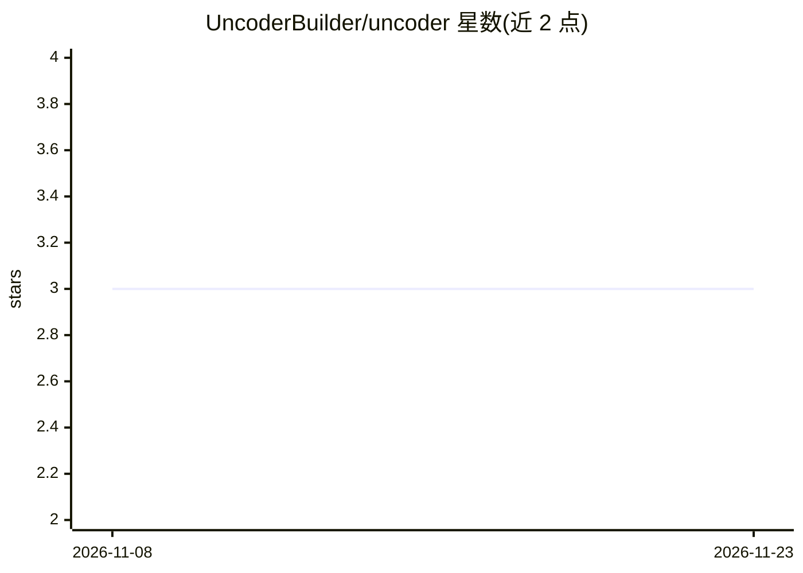

# UncoderBuilder/uncoder

⭐ 3 · PHP · GPL-2.0 · 推送 2026-11-07 · [GitHub](https://github.com/UncoderBuilder/uncoder) · [官网](https://uncoderbuilder.com) · 组织维护

**给 WordPress 用户的可视化页面构建器，内置 MCP 供 AI 操控**

面向 WordPress 用户与站长的可视化页面/主题构建器插件：提供 flexbox 与 grid 容器的可视化编辑、100+ 组件、主题构建器、WooCommerce 页面支持和设计系统。关键 AI 机制为内置 MCP 服务器，暴露 58 个带权限控制和活动日志的工具，使 Claude、ChatGPT、Cursor 等 AI 应用能用与用户相同的组件构建和编辑站点。支持一键撤销的还原点。限制：仓库发布的是编译后脚本，前端 TypeScript/React 源码需邮件索取。

## 筛选速览

| 维度 | 判定 | 备注 |
|---|---|---|
| AI 角色 | `ai-enhanced` | 去掉 AI 部分产品仍成立 |
| 许可风险 | `viral` | GPL-2.0 |
| 部署形态 | `desktop` | 安装包/桌面程序 |
| 模型依赖 | — | README 未给出锁定关系 |
| 硬件要求 | — | 无带数字的原话,不猜 |
| 安装摩擦 | `low` | 无编译、无系统依赖或容器化 |
| 成熟度 | — | 结构信号不足 |

## 能力要点

- 内置 MCP 服务器，暴露 58 个带权限与活动日志的工具
- 可视化编辑器含 flexbox/grid 容器、100+ 组件、40 种区块模式
- 主题构建器覆盖页头、页脚、存档、404、弹窗等模板
- 每次导入可一键撤销的还原点机制

## 适用场景

- 在 WordPress 中拖拽式搭建页面和主题模板
- 让 AI 应用代为构建和编辑 WordPress 站点
- 为 WooCommerce 搭建商品页、购物车、结算页

## 场景标签

 · 领域:网站建设/CMS 工具

## 证据(README 行号)

> L3: A free visual page and theme builder for WordPress — with an MCP server built in, so Claude, ChatGPT,
> L8: - WooCommerce: product pages, the shop, cart, checkout, account and a header mini cart, with WooCommerce still in ch
> L11: - 58 MCP tools with permissions, an activity log and one-click undo

## 星数曲线

2026-11-08 3 → 2026-11-23 3（+0）

---
*卡片 v1 · prompt 1.4 · 生成 2026-11-22 · 置信度 high · 依据 README sha `67aef6ba3076` · [字段定义](../../DATASET.md)*
