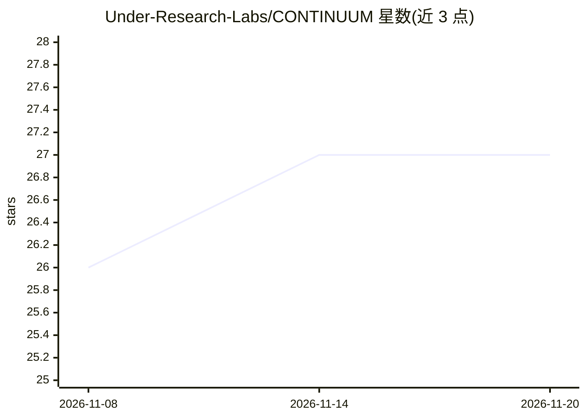

# Under-Research-Labs/CONTINUUM

⭐ 27 · Python · Apache-2.0 · 推送 2026-11-19 · [GitHub](https://github.com/Under-Research-Labs/CONTINUUM) · [官网](https://continuum-nu-six.vercel.app) · 组织维护

**为长时运行 AI agent 提供语义检查点与崩溃恢复的基础设施**

面向长时运行 AI agent 的恢复基础设施：将任务状态保存为语义检查点而非对话记录，恢复前对每项状态在当前环境中独立再校验；通过幂等动作账本拒绝重复副作用，事件日志以哈希链保证防篡改。对外暴露为默认拒绝的 MCP 服务器，附 CLI、强制网关与 OpenTelemetry 桥。框架无关，核心库仅依赖 pydantic，浏览器与 Kubernetes 适配器为可选扩展；支持 Claude Code/Gemini CLI/Codex 钩子集成。Python 3.11+。

## 筛选速览

| 维度 | 判定 | 备注 |
|---|---|---|
| AI 角色 | `ai-ecosystem` | LLM/agent 周边工具 |
| 许可风险 | `permissive` | Apache-2.0 |
| 部署形态 | `self-host` | docker 或自建部署 |
| 模型依赖 | — | README 未给出锁定关系 |
| 硬件要求 | — | 无带数字的原话,不猜 |
| 安装摩擦 | `low` | 无编译、无系统依赖或容器化 |
| 成熟度 | `idea` | |

## 能力要点

- 语义检查点：紧凑、版本化、可检查的任务状态表示
- 幂等动作账本：拒绝重复副作用，未声明副作用在触发前被拦截
- 哈希链防篡改事件日志（57 种事件类型）与完整性校验
- 默认拒绝的 MCP 服务器：13 个工具，只读/变更分离与调用方白名单

## 适用场景

- 长任务 agent 崩溃后从语义检查点恢复，不重放全部工作
- 对 agent 写入的文件做摘要验证，作为不可被模型控制的证据
- 编写 coding agent 的钩子，让每次会话自动带状态简报与恢复步骤
- 通过强制网关在副作用触发前校验其已登记

## 场景标签

`Agent 记忆` · 领域:Agent 开发

## 证据(README 行号)

> L3:  CONTINUUM: Verifiable semantic recovery for long-running AI agents.
> L6:  log, all exposed as a deny-by-default MCP server. Framework-agnostic,
> L87: The core library has one runtime dependency (`pydantic>=2.7`); everything else is opt-in. The full package map, ext

## 星数曲线

2026-11-08 26 → 2026-11-20 27（+1）

---
*卡片 v1 · prompt 1.4 · 生成 2026-11-18 · 置信度 high · 依据 README sha `b845d1543c8b` · [字段定义](../../DATASET.md)*
