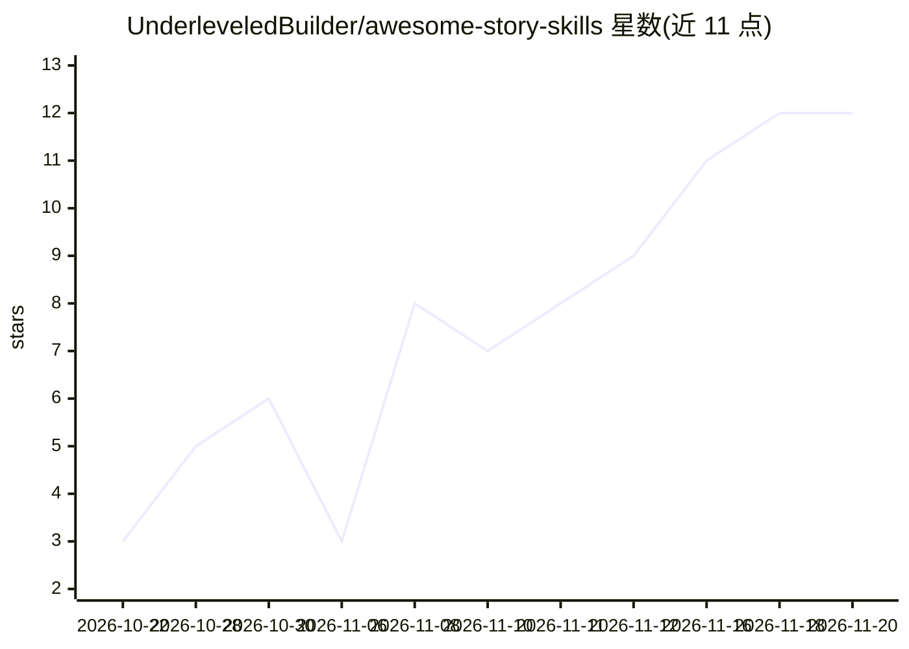

# UnderleveledBuilder/awesome-story-skills

⭐ 12 · Python · CC0-1.0 · 推送 2026-11-17 · [GitHub](https://github.com/UnderleveledBuilder/awesome-story-skills) · 个人维护 · 中文 README

**可安装的 AI 写故事工具清单：845 个 skill/应用按叙事方法分类**

面向用大模型写小说、网文、剧本、短剧、互动叙事、同人仿写和非虚构叙事的用户，收录 845 个可安装使用的开源项目：356 个 skill 与提示词、467 个框架与应用、22 个研究代码。收录标准是故事由大模型生成且项目提供叙事方法（规划、记忆、多智能体审稿、去 AI 味等）；下载、翻译、通用润色等周边工具不收。每个条目按故事类型归类并标注所用方法，附 catalog.json 机器可读索引，可通过 npx 安装 storytelling-methods skill 让 agent 推荐方法。维护者声明人工核对仅覆盖仓库说明与分类，不等于实测写作效果。

## 筛选速览

| 维度 | 判定 | 备注 |
|---|---|---|
| AI 角色 | `ai-knowledge` | 知识聚合/清单类 |
| 许可风险 | `viral` | CC0-1.0 |
| 部署形态 | `self-host` | docker 或自建部署 |
| 模型依赖 | — | README 未给出锁定关系 |
| 硬件要求 | — | 无带数字的原话,不猜 |
| 安装摩擦 | `low` | 无编译、无系统依赖或容器化 |
| 成熟度 | — | 结构信号不足 |

## 能力要点

- 收录 845 个项目：356 个 skill/提示词、467 个框架/应用、22 个研究代码
- 按故事类型归类并标注叙事方法，另附方法指南
- 提供 catalog.json 机器可读索引与 npx 安装的选型 skill
- 条目标注更新时间、语言、许可证与失效/归档状态

## 适用场景

- 我要写 300 章修仙网文，帮我挑一套长篇写作 skill
- 想找能把一条新闻写成有事实出处的解说说故事的工具
- 做互动小说或跑团引擎，看看有哪些多 agent 叙事框架
- 想找带去 AI 味、伏笔追踪和连续性审查的网文插件

## 场景标签

`AI 写作` `精选清单` · 领域:内容生成

## 证据(README 行号)

> L5: > 能直接装、直接用的大模型讲故事开源工具，不是论文清单：skill、agent 框架、应用，以及放出了代码的研究。小说、网文、短篇、剧本、互动叙事、同人仿写，以及把真实事件写得像小说一样好看的非虚构叙事，都收。
> L9: 这里只收一类项目：故事主要由大模型写出来，项目本身提供的是讲故事的方法或原则，比如怎么先规划再写、怎么让长篇不吃书、怎么让多个 agent 分工审稿、怎么学一部作品的写法、怎么把一条新闻写成有悬念又不编造事实的故事。下载、发布、翻译
> L15: 收录 845 个项目：356 个 skill 和提示词、467 个框架和应用、22 个研究代码 · 元数据更新于 2026-11-16

## 星数曲线

2026-10-22 3 → 2026-11-20 12（+9）

---
*卡片 v1 · prompt 1.4 · 生成 2026-11-18 · 置信度 mid · 依据 README sha `4806f04352dd` · [字段定义](../../DATASET.md)*
