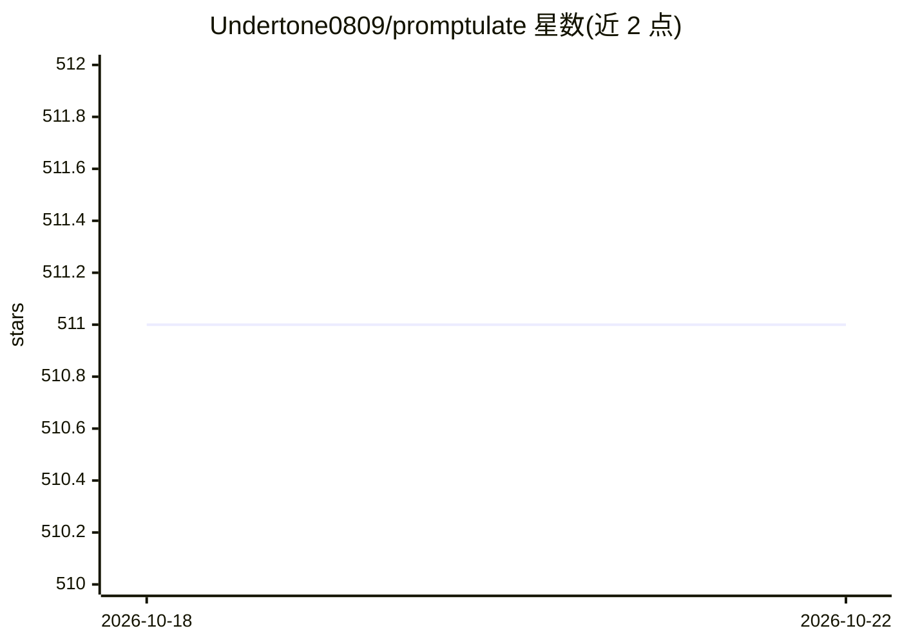

# Undertone0809/promptulate

⭐ 511 · Python · Apache-2.0 · 推送 2026-07-14 · [GitHub](https://github.com/Undertone0809/promptulate) · [官网](https://promptulate.cn/) · 组织维护 · 中文 README

**Pythonic 的 LLM Agent 应用开发框架（pne）**

由 Cogit Lab 开发的 AI Agent 应用开发框架，核心入口 pne.chat() 封装 LLM 调用，可替代 OpenAI SDK 并提供结构化输出（Pydantic）、Prompt 缓存、Hooks 生命周期管理。提供 ToolAgent/CodeAgent/WebAgent 等多类 Agent，支持计划-推理-执行模式与原子化组件（如单独的 Planner）；Python 函数可直接转为 Agent 工具，并集成 LangChain 工具。通过 litellm 支持市面多数大模型（OpenAI/Anthropic/Ollama/vLLM 等）。需 Python 3.8+，pip 安装。

## 筛选速览

| 维度 | 判定 | 备注 |
|---|---|---|
| AI 角色 | `ai-ecosystem` | LLM/agent 周边工具 |
| 许可风险 | `permissive` | Apache-2.0 |
| 部署形态 | `library` | 以包/库形式分发 |
| 模型依赖 | local-ok | 支持本地模型 |
| 硬件要求 | — | 无带数字的原话,不猜 |
| 安装摩擦 | `low` | 无编译、无系统依赖或容器化 |
| 成熟度 | — | 结构信号不足 |

## 能力要点

- pne.chat() 单一入口封装 LLM 调用，可替代 OpenAI SDK
- 基于 litellm 支持多种大模型提供商（含 Ollama、vLLM 本地运行时）
- Agent 支持 Plan-and-Execute 规划、工具调用与反思，组件可原子化拆用
- 任意 Python 函数可直接转为 Agent 工具，兼容 LangChain 工具

## 适用场景

- 用几行 Python 代码快速构建 LLM 聊天或结构化输出应用
- 开发带规划、工具调用与反思能力的 Agent 应用
- 统一接口切换调用 OpenAI、Anthropic、本地 Ollama 等多种模型

## 场景标签

`Agent 框架` · 领域:Agent 开发

## 证据(README 行号)

> L23: **Promptulate** is an AI Agent application development framework crafted by **Cogit Lab**, which offers developers 
> L28: - 🧠 Model Compatibility: Supports nearly all types of large models on the market and allows for easy customization 
> L48: Promptulate integrates the capabilities of litellm, supporting nearly all types of large models on the market, incl

## 星数曲线

2026-10-18 511 → 2026-10-22 511（+0）

---
*卡片 v1 · prompt 1.4 · 生成 2026-10-21 · 置信度 high · 依据 README sha `25541880e15b` · [字段定义](../../DATASET.md)*
