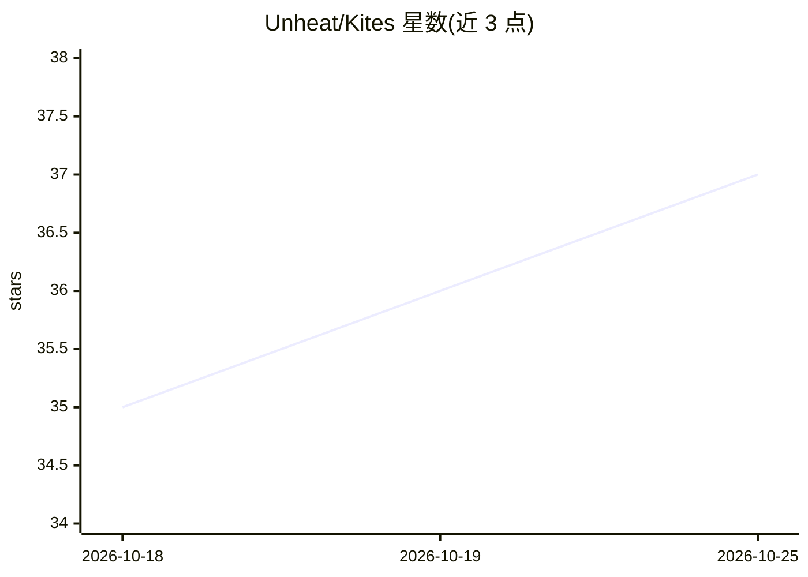

# Unheat/Kites

⭐ 37 · TypeScript · GPL-3.0 · 推送 2026-10-25 · [GitHub](https://github.com/Unheat/Kites) · [官网](https://kites-translator.pages.dev/) · 个人维护

**浏览器内本地 AI 漫画翻译扩展：OCR、修复与排版**

Chrome MV3 扩展，面向漫画读者，在浏览器内完成端到端翻译：PaddleOCR v3-v6 做文字检测识别，LaMa Manga/AOT-GAN 等算法做背景修复，YOLO/启发式做气泡适配与自动排版；翻译可选 WebLLM（WebGPU 本地运行 Qwen/Gemma/Llama 等）、Google Translate、共享云端池或自定义 OpenAI/Claude/Gemini API。全部处理在本地设备进行，图片不上传。支持悬停翻译、整章批量翻译与 ZIP 导出，内置 Kites Studio 编辑器。通过 Chrome 应用商店、Release zip 或源码构建安装。

## 筛选速览

| 维度 | 判定 | 备注 |
|---|---|---|
| AI 角色 | `ai-native` | 本体是模型或模型工具 |
| 许可风险 | `viral` | GPL-3.0 |
| 部署形态 | `desktop` | 安装包/桌面程序 |
| 模型依赖 | — | README 未给出锁定关系 |
| 硬件要求 | — | 无带数字的原话,不猜 |
| 安装摩擦 | `medium` | 含编译或系统依赖之一 |
| 成熟度 | — | 结构信号不足 |

## 能力要点

- WebGPU 本地运行 OCR、修复与 LLM 翻译，图片不离开浏览器
- PaddleOCR v3-v6 多语言文字检测识别
- LaMa Manga/AOT-GAN/Telea 等多种修复算法
- 整章批量翻译、ZIP 离线导出与内置 Studio 编辑器

## 适用场景

- 浏览 Twitter/X、Pixiv、漫画站时悬停即时翻译漫画对白
- 整章或长条 webtoon 一键批量翻译并离线保存
- 不装 Python 环境在浏览器里完成私有化漫画翻译

## 场景标签

`OCR` `图像视频处理` · 领域:感知与多模态

## 证据(README 行号)

> L6: **Zero Python • Zero Servers • 100% Private In-Browser Extension AI Translation**
> L28: **Kites changes that.** It is a lightweight Chrome extension that runs state-of-the-art vision and language models 
> L31: - 🔒 **100% Local & Private:** Optical character recognition (OCR) and background cleaning happen on your device. Yo

## 星数曲线

2026-10-18 35 → 2026-10-25 37（+2）

---
*卡片 v1 · prompt 1.4 · 生成 2026-10-25 · 置信度 high · 依据 README sha `f3e00216bb95` · [字段定义](../../DATASET.md)*
