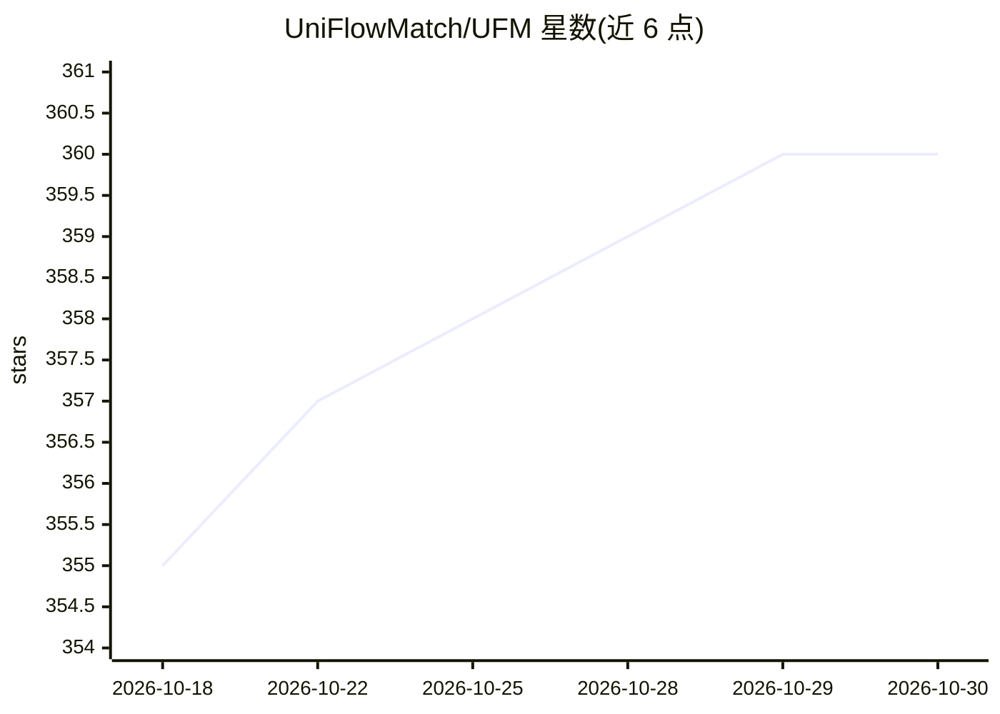

# UniFlowMatch/UFM

⭐ 360 · Python · BSD-3-Clause · 推送 2026-10-15 · [GitHub](https://github.com/UniFlowMatch/UFM) · [官网](https://uniflowmatch.github.io/) · 组织维护

**统一光流与宽基线匹配的稠密图像对应估计模型（NeurIPS 2025）**

CMU 团队提出的端到端 transformer 模型 UFM，直接回归像素位移（flow），同时适用于光流估计与宽基线匹配两类任务，对任意图像对输出稠密对应。提供 6 个规模 0.3B–1B 的 HuggingFace 检查点与推理运行耗时数据，基于 UniCeption 库构建，安装采用递归克隆源码方式，附带 CLI、Python API 与本地/在线 Gradio 演示。代码为 BSD-3-Clause，但预训练模型检查点继承训练数据许可（CC BY-NC-SA 4.0），不可商用。

## 筛选速览

| 维度 | 判定 | 备注 |
|---|---|---|
| AI 角色 | `ai-native` | 本体是模型或模型工具 |
| 许可风险 | `permissive` | BSD-3-Clause |
| 部署形态 | `None` |  |
| 模型依赖 | — | README 未给出锁定关系 |
| 硬件要求 | — | 无带数字的原话,不猜 |
| 安装摩擦 | `low` | 无编译、无系统依赖或容器化 |
| 成熟度 | — | 结构信号不足 |

## 能力要点

- 单一模型统一光流估计与宽基线匹配两类任务
- 直接回归像素位移图，端到端训练
- 6 个 HuggingFace 检查点（0.3B–1B 参数），含 980 分辨率与 DINOv2 初始化版本
- 提供 CLI、Python API 与本地/在线 Gradio 交互演示

## 适用场景

- 对任意图像对估计稠密像素对应关系
- 机器人、三维重建等场景的光流与宽基线匹配
- 通过在线 demo 免安装试用模型效果

## 场景标签

 · 领域:计算机视觉/图像对应

## 证据(README 行号)

> L12:  UFM unifies the tasks of Optical Flow Estimation and Wide Baseline Matching and provides accurate dense correspond
> L38: UFM (Unified Flow & Matching, UniFlowMatch) is a simple, end-to-end trained transformer model that directly regress

## 星数曲线

2026-10-18 355 → 2026-10-30 360（+5）

---
*卡片 v1 · prompt 1.4 · 生成 2026-10-21 · 置信度 high · 依据 README sha `b1299c55888f` · [字段定义](../../DATASET.md)*
