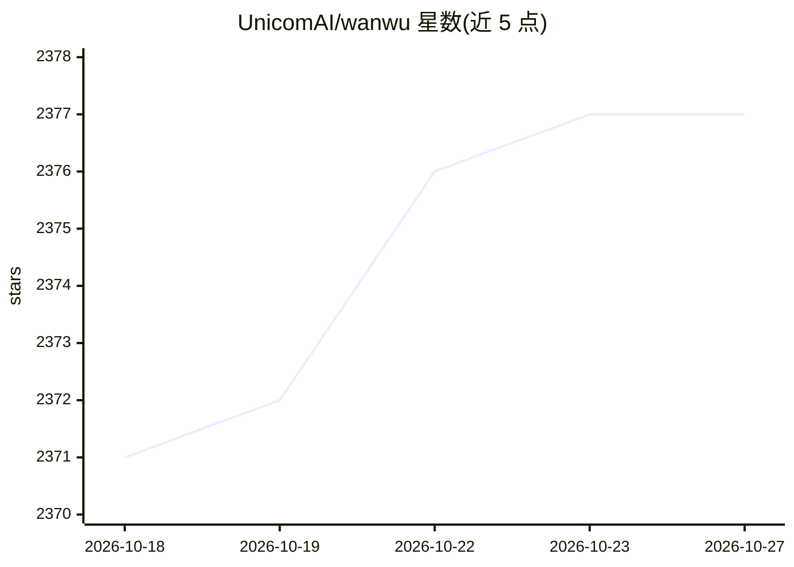

# UnicomAI/wanwu

⭐ 2,377 · Go · Apache-2.0 · 推送 2026-10-23 · [GitHub](https://github.com/UnicomAI/wanwu) · 组织维护 · 中文 README

**企业级多租户 AI Agent 开发平台，构建智能体、工作流与 RAG**

中国联通元景推出的开源 Agent 开发平台，面向企业与现场交付工程师（FDE），提供 RAG/知识库、本体、工作流、GUI、通用 Agent 五类核心能力，覆盖模型管理（统一接入数百个专有/开源模型、OpenAI API 兼容、vLLM/TGI 等推理后端）、MCP 接口、联网搜索、可视化低代码工作流与 RESTful API（BaaS）集成。支持多租户架构与信创环境（鲲鹏、Euler、麒麟等），采用 Apache-2.0 许可证，提供 Docker 部署等 3 种落地路径。

## 筛选速览

| 维度 | 判定 | 备注 |
|---|---|---|
| AI 角色 | `ai-ecosystem` | LLM/agent 周边工具 |
| 许可风险 | `permissive` | Apache-2.0 |
| 部署形态 | `self-host` | docker 或自建部署 |
| 模型依赖 | local-ok | 支持本地模型 |
| 硬件要求 | — | 无带数字的原话,不猜 |
| 安装摩擦 | `low` | 无编译、无系统依赖或容器化 |
| 成熟度 | — | 结构信号不足 |

## 能力要点

- 5 类核心 Agent 能力：RAG/知识库、本体、工作流、GUI（Docker 沙箱）、通用 Agent+技能
- 模型管理支持数百个专有/开源模型统一接入，OpenAI API 兼容与多推理后端（vLLM/TGI）
- 内置 100+ 行业 MCP 接口与 100+ 内置技能，支持一句话创建技能
- 多租户架构与信创适配（鲲鹏 CPU、Euler、Kylin、TiDB、OceanBase 等）

## 适用场景

- 企业搭建知识库问答与 RAG 应用
- 通过低代码画布编排复杂业务流程（合同审查、费用审批等）
- 将 AI 能力以 RESTful API 嵌入 OA/CRM/ERP 系统
- 在信创环境本地化部署 AI Agent 平台

## 场景标签

`工作流自动化` `RAG` `Agent 框架` · 领域:Agent 开发

## 证据(README 行号)

> L19: Yuanjing Wanwu Agent Platform is an **all-in-one, commercial-friendly licensed agent development platform** designe
> L102: #### **1. Model Management (Model Hub)**
> L121: #### **4. Visual Workflow (Workflow Studio)**

## 星数曲线

2026-10-18 2,371 → 2026-10-27 2,377（+6）

---
*卡片 v1 · prompt 1.4 · 生成 2026-10-21 · 置信度 high · 依据 README sha `9c6ee6578cae` · [字段定义](../../DATASET.md)*
