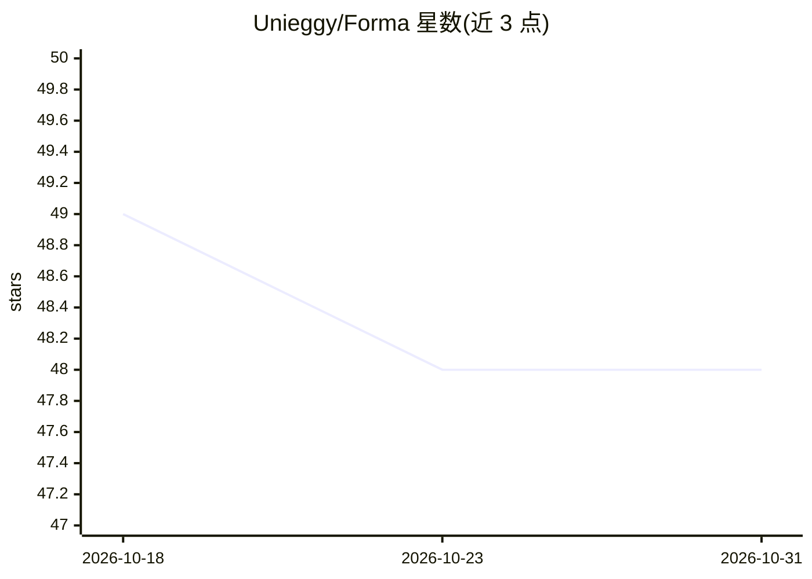

# Unieggy/Forma

⭐ 48 · TypeScript · 推送 2026-08-09 · [GitHub](https://github.com/Unieggy/Forma) · 个人维护

**本地优先的论文阅读工作台：选中公式/图表/段落获得逐步讲解**

面向研读技术论文的读者：加载 PDF 后在浏览器内完成解析与渲染，构建语义论文地图（章节、关键公式、方法、图表）。用户点击段落、公式或图片作为上下文提问，获得逐步讲解——公式按整体到逐项再到数值示例展开，流程/架构按编号顺序追踪，ML 论文可做张量形状逐轴追踪（含 ASCII 草图）。回答通过本地登录的 agent CLI（Codex/ChatGPT、Claude Code、Gemini）生成，PDF 不离开浏览器，无 API key 与云存储。以 Next.js 源码形式提供，npm 安装运行，macOS 有启动脚本；限制是需先本地登录至少一个 agent CLI。

## 筛选速览

| 维度 | 判定 | 备注 |
|---|---|---|
| AI 角色 | `ai-native` | 本体是模型或模型工具 |
| 许可风险 | `none` | — |
| 部署形态 | `library` | 以包/库形式分发 |
| 模型依赖 | — | README 未给出锁定关系 |
| 硬件要求 | — | 无带数字的原话,不猜 |
| 安装摩擦 | `low` | 无编译、无系统依赖或容器化 |
| 成熟度 | — | 结构信号不足 |

## 能力要点

- 选中公式/图表/段落后生成基于论文的逐步讲解
- ML 论文的张量形状逐轴追踪与 ASCII 草图
- 语义论文地图与本地论文库（每篇 PDF 保留对话、笔记、阅读位置）
- PDF 不离开浏览器，仅提取文本发送给本地登录的 agent

## 适用场景

- 读论文时卡在难懂的公式或推导步骤，选中后追问逐步解释
- 追踪 ML/机器人论文中张量从输入到输出的维度变化
- 在不把论文上传云端的前提下获得 AI 辅助阅读

## 场景标签

`科研工具` `文档问答` · 领域:知识与检索

## 证据(README 行号)

> L24: Load a PDF and Forma reads the whole thing to build a **semantic paper map**. Click any paragraph,
> L53: The PDF is parsed and rendered entirely in the browser. When you ask a question, the extracted
> L61:  PDF (in browser)  ──►  paper map + selection  ──►  local agent CLI  ──►  adaptive walkthrough

## 星数曲线

2026-10-18 49 → 2026-10-31 48（-1）

---
*卡片 v1 · prompt 1.4 · 生成 2026-10-25 · 置信度 high · 依据 README sha `03616e4fc864` · [字段定义](../../DATASET.md)*
