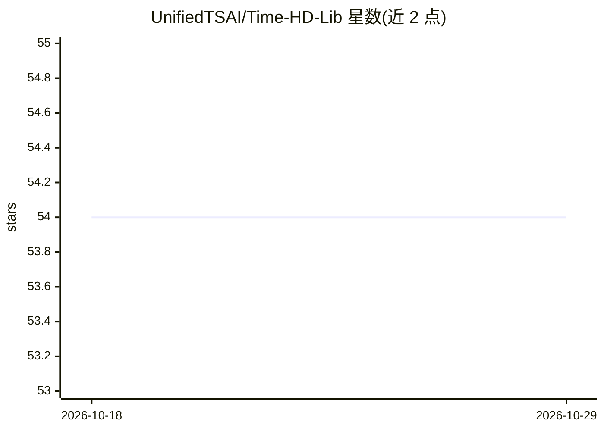

# UnifiedTSAI/Time-HD-Lib

⭐ 54 · Python · MIT · 推送 2026-01-26 · [GitHub](https://github.com/UnifiedTSAI/Time-HD-Lib) · 组织维护

**面向科研者的高维时间序列预测框架：20+模型统一接口**

基于 PyTorch 的高维时间序列预测框架：收录 UCast、PatchTST、iTransformer、TimesNet 等 20 余个 2017-2024 年模型，提供统一接口，支持通过 HuggingFace Accelerate 进行多 GPU/多节点分布式训练、自动超参数搜索（含自动批大小回退与混合精度）、批处理实验与结果管理。数据方面支持 Time-HD 高维基准（经 HuggingFace Datasets 获取，需登录授权）及 ETT/Weather/Traffic/ECL 等传统基准，并给出添加新模型与新数据集的扩展流程。MIT 许可，以源码方式安装使用。

## 筛选速览

| 维度 | 判定 | 备注 |
|---|---|---|
| AI 角色 | `ai-native` | 本体是模型或模型工具 |
| 许可风险 | `permissive` | MIT |
| 部署形态 | `None` |  |
| 模型依赖 | — | README 未给出锁定关系 |
| 硬件要求 | — | 无带数字的原话,不猜 |
| 安装摩擦 | `low` | 无编译、无系统依赖或容器化 |
| 成熟度 | — | 结构信号不足 |

## 能力要点

- 20+ 时间序列预测模型统一接口（2017-2024）
- HuggingFace Accelerate 多 GPU/多节点分布式训练
- 自动超参数搜索，OOM 时自动缩减批大小，支持 fp16 混合精度
- 支持 Time-HD 高维基准与传统基准数据集，附模型/数据集扩展指南

## 适用场景

- 在数千维数据集上运行并对比多个时序预测模型
- 做多 GPU 分布式训练与自动超参数搜索
- 复现或扩展时序预测研究实验并管理结果

## 场景标签

`科研工具` · 领域:学习与行业

## 证据(README 行号)

> L8: A comprehensive, production-ready framework for high-dimensional time series forecasting with support for 20+ state-
> L13: - **🤖 20+ SOTA Models**: Latest time series forecasting models (2017-2024) with unified interface
> L14: - **🚀 Distributed Training**: Built-in multi-GPU support with HuggingFace Accelerate

## 星数曲线

2026-10-18 54 → 2026-10-29 54（+0）

---
*卡片 v1 · prompt 1.4 · 生成 2026-10-24 · 置信度 high · 依据 README sha `910073b61e7f` · [字段定义](../../DATASET.md)*
