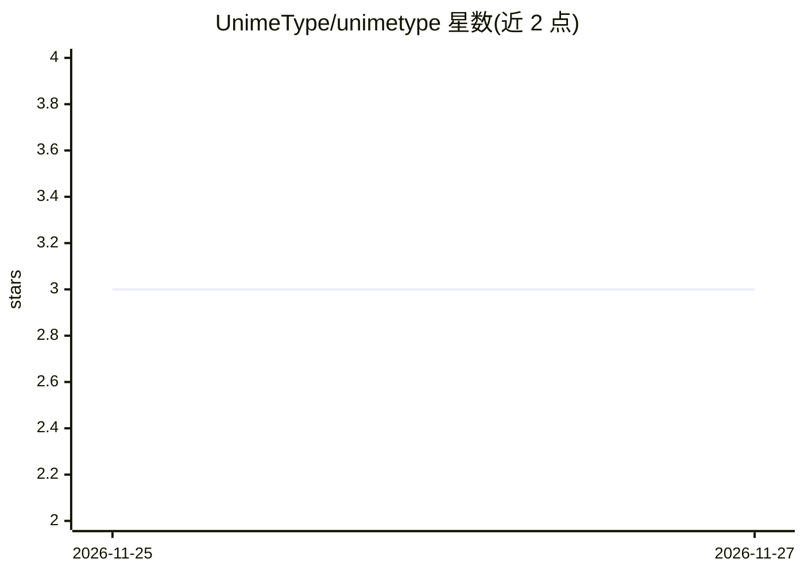

# UnimeType/unimetype

⭐ 3 · Shell · 推送 2026-11-22 · [GitHub](https://github.com/UnimeType/unimetype) · [官网](https://unimetype.com) · 组织维护

**双语者输入法：ASCII 打字后一键转写为母语文字**

UnimeType 是覆盖 macOS/Windows/Linux/iOS/Android/ChromeOS 的输入法客户端，本仓库为其社区门户、包管理器索引与公开 issue tracker。核心机制是把打字与转换分离：键盘始终停留在 QWERTY/ASCII，按 Caps Lock（或移动端 Convert）将拼音/罗马字/Arabizi 等音标草稿就地转写为母语文字，保留英文词、@handle、URL、路径与代码。桌面端可指向本地 OpenAI 兼容运行时（LM Studio/Ollama 等）实现离线转换，模型权重以 Apache-2.0 发布于 Hugging Face。

## 筛选速览

| 维度 | 判定 | 备注 |
|---|---|---|
| AI 角色 | `ai-native` | 本体是模型或模型工具 |
| 许可风险 | `none` | — |
| 部署形态 | `desktop` | 安装包/桌面程序 |
| 模型依赖 | local-ok | 支持本地模型 |
| 硬件要求 | — | 无带数字的原话,不猜 |
| 安装摩擦 | `low` | 无编译、无系统依赖或容器化 |
| 成熟度 | — | 结构信号不足 |

## 能力要点

- 打字与转换分离：Caps Lock 触发音标草稿就地转写，保护英文词/URL/代码
- 支持中/日/印地/阿拉伯/俄语等 12 种语言与浏览器免费转换器
- 桌面端 100% 离线转换，可接 LM Studio/Ollama/mlx_lm.server/llama-server
- 开源 0.8B/4B/9B 权重（Safetensors/GGUF）与 Smoke-60 基准

## 适用场景

- 在 Figma/Overleaf/Vim 等工具中混输中英日文时不打断快捷键
- WhatsApp/微信/Slack 中切换语言无需切换键盘布局
- 隐私敏感场景下用本地模型离线完成音标转写

## 场景标签

 · 领域:输入法/效率工具

## 证据(README 行号)

> L7:  One keyboard for all your languages, without switching keyboards across apps or mid-sentence.
> L28: UnimeType separates **typing** from **converting**: your keyboard stays in clean, predictable ASCII at all times, a
> L59: Desktop clients (`macOS`, `Windows`, `Linux`) support **100% offline on-device conversion** through any local OpenA

## 星数曲线

2026-11-25 3 → 2026-11-27 3（+0）

---
*卡片 v1 · prompt 1.4 · 生成 2026-11-24 · 置信度 high · 依据 README sha `d412be00b818` · [字段定义](../../DATASET.md)*
