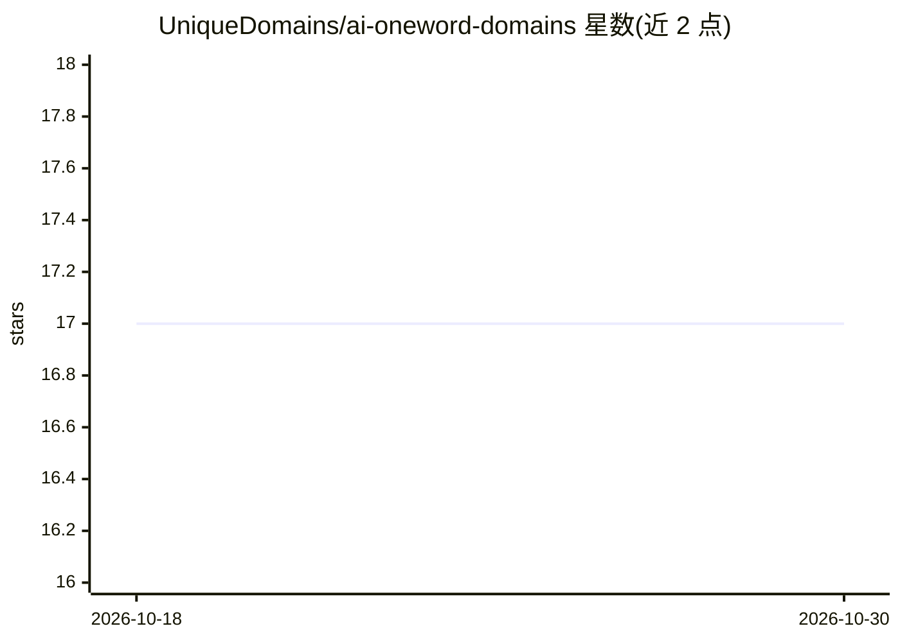

# UniqueDomains/ai-oneword-domains

⭐ 17 · NOASSERTION · 推送 2026-10-29 · [GitHub](https://github.com/UniqueDomains/ai-oneword-domains) · [官网](https://unique.domains/tld/ai) · 组织维护

**给创始人/投资者的 .ai 单词域名公开数据集（1,000 行抽取）**

Unique Domains 维护的 .ai 一词域名公开数据集仓库：发布 1,000 行 CSV/JSON 抽取，对应 20,078 条的完整在线目录，字段含域名、状态（available/resell）、要价、续费价、吸引力/需求分级、注册商、核验时间等；附带数据字典、方法论、变更日志与 CITATION.cff 引用元数据。面向创始人、投资者与工作室，提供 pandas 直读 URL，并引导至其平台的 Radar/告警/API 等付费工作流。注意仓库仅为静态抽取，行状态可能滞后于快照日期。

## 筛选速览

| 维度 | 判定 | 备注 |
|---|---|---|
| AI 角色 | `ai-knowledge` | 知识聚合/清单类 |
| 许可风险 | `none` | NOASSERTION |
| 部署形态 | `None` |  |
| 模型依赖 | — | README 未给出锁定关系 |
| 硬件要求 | — | 无带数字的原话,不猜 |
| 安装摩擦 | `low` | 无编译、无系统依赖或容器化 |
| 成熟度 | — | 结构信号不足 |

## 能力要点

- 1,000 行 CSV/JSON 公开抽取，对应 20,078 条在线目录
- 字段覆盖状态、要价、续费价、吸引力/需求分级、注册商、核验时间
- 提供数据字典、方法论说明与 CITATION.cff 机器可读引用元数据
- 支持 pandas 直接从 raw URL 读取

## 适用场景

- 为初创项目筛选可注册的 .ai 单词域名
- 域名投资分析要价、需求分级与转售状态
- 作为可引用的数据集用于域名市场研究

## 场景标签

 · 领域:域名/数据集

## 证据(README 行号)

> L10: Daily-updated public extract of available and resale .ai one-word domains from Unique Domains.
> L38: - `ai.csv`, public CSV extract (1,000 rows)
> L39: - `ai.json`, public JSON extract (1,000 rows)

## 星数曲线

2026-10-18 17 → 2026-10-30 17（+0）

---
*卡片 v1 · prompt 1.4 · 生成 2026-10-29 · 置信度 high · 依据 README sha `3da3c4c5fcb4` · [字段定义](../../DATASET.md)*
