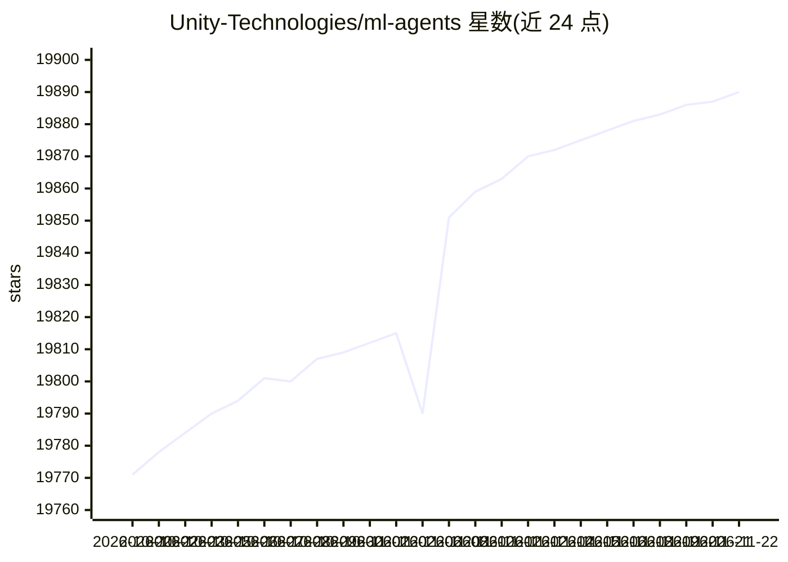

# Unity-Technologies/ml-agents

⭐ 19,890 · C# · NOASSERTION · 推送 2026-11-21 · [GitHub](https://github.com/Unity-Technologies/ml-agents) · [官网](https://unity.com/products/machine-learning-agents) · 组织维护

**让 Unity 游戏与仿真成为强化学习智能体训练环境的工具包**

Unity 官方开源的机器学习智能体工具包：将游戏与仿真场景作为训练环境，使用深度强化学习与模仿学习训练智能体。文档覆盖安装说明、Unity 与 Python 版本兼容性、功能特性、教程与 API 参考，并给出学术引用方式；社区支持通过 Unity 官方讨论论坛与 GitHub issue 进行。项目由 Unity Technologies 维护，以 Unity 包形式分发，配合 Unity 编辑器与 Python 环境运行。

## 筛选速览

| 维度 | 判定 | 备注 |
|---|---|---|
| AI 角色 | `ai-native` | 本体是模型或模型工具 |
| 许可风险 | `none` | NOASSERTION |
| 部署形态 | `None` |  |
| 模型依赖 | — | README 未给出锁定关系 |
| 硬件要求 | — | 无带数字的原话,不猜 |
| 安装摩擦 | `low` | 无编译、无系统依赖或容器化 |
| 成熟度 | — | 结构信号不足 |

## 动量与使用信号

- 维护:`active` — 距上次 push 4.7 天,年发版 0,151 位贡献者
- 涨星:近 1 天 **+0**(自 20261016 起算)

## 能力要点

- 支持深度强化学习与模仿学习训练智能体
- 将游戏和仿真作为训练环境接入
- 提供安装指南、版本兼容性、教程与 API 参考文档

## 适用场景

- 在 Unity 场景中训练游戏 NPC 或仿真智能体
- 做强化学习与模仿学习相关研究并在论文中引用
- 为智能体训练搭建仿真环境

## 场景标签

`强化学习` · 领域:训练与推理

## 证据(README 行号)

> L9: The **Unity Machine Learning Agents Toolkit** (ML-Agents) is an open-source project that enables games and simulatio
> L13: The ML-Agents package documentation is the primary documentation for ML-Agents. It includes installation instructio
> L17: To install ML-Agents and check which Unity and Python versions are compatible, refer to Install the ML-Agents Toolk

## 星数曲线

2026-10-20 19,771 → 2026-11-22 19,890（+119）

---
*卡片 v1 · prompt 1.4 · 生成 2026-11-22 · 置信度 high · 依据 README sha `8951fc0c7697` · [字段定义](../../DATASET.md)*
