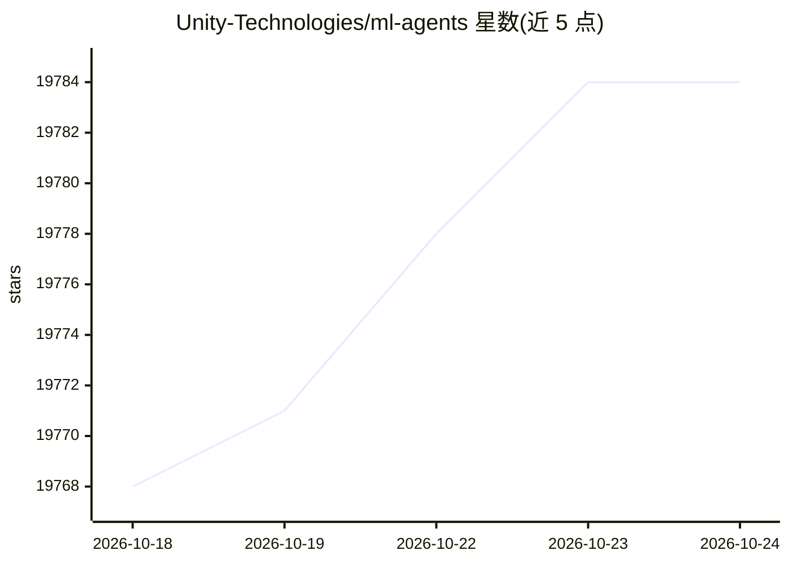

# Unity-Technologies/ml-agents

⭐ 19,790 · C# · NOASSERTION · 推送 2026-10-23 · [GitHub](https://github.com/Unity-Technologies/ml-agents) · [官网](https://unity.com/products/machine-learning-agents) · 组织维护

**让游戏与仿真成为强化学习智能体训练环境的 Unity 工具包**

Unity 官方开源项目，将 2D/3D/VR/AR 游戏与仿真作为智能体训练环境：基于 PyTorch 提供 PPO、SAC、MA-POCA、自博弈等深度强化学习算法和 BC、GAIL 模仿学习算法，含 17+ 示例环境、课程学习、多实例并发训练。通过 Python API 和 Gym/PettingZoo 封装供研究人员使用，训练产物可经 Inference Engine 跨平台推理。以 Unity 包（com.unity.ml-agents）+ Python 包双组件发布，已迁移至 Unity Package 文档并停止维护 web 文档。

## 筛选速览

| 维度 | 判定 | 备注 |
|---|---|---|
| AI 角色 | `ai-native` | 本体是模型或模型工具 |
| 许可风险 | `none` | NOASSERTION |
| 部署形态 | `desktop` | 安装包/桌面程序 |
| 模型依赖 | — | README 未给出锁定关系 |
| 硬件要求 | — | 无带数字的原话,不猜 |
| 安装摩擦 | `low` | 无编译、无系统依赖或容器化 |
| 成熟度 | — | 结构信号不足 |

## 动量与使用信号

- 维护:`active` — 距上次 push 4.7 天,年发版 0,151 位贡献者
- 涨星:近 1 天 **+0**(自 20261016 起算)

## 能力要点

- 基于 PyTorch 的 PPO/SAC/MA-POCA/自博弈等强化学习与 BC/GAIL 模仿学习实现
- 17+ 示例 Unity 环境，支持单智能体、多智能体合作与对抗训练
- 可封装为 Gym 与 PettingZoo 环境，从 Python 控制 Unity 环境
- 经 Inference Engine 提供原生跨平台推理支持

## 适用场景

- 训练控制 NPC 行为的智能体（含多智能体与对抗场景）
- 对游戏构建做自动化测试
- 发布前评估不同游戏设计决策
- 研究人员用 Python API 做强化学习/模仿学习/神经进化实验

## 场景标签

`强化学习` `多智能体` · 领域:Agent 开发

## 证据(README 行号)

> L9: **The Unity Machine Learning Agents Toolkit** (ML-Agents) is an open-source project that enables games and simulatio
> L15: - Support for training single-agent, multi-agent cooperative, and multi-agent competitive scenarios via several Dee
> L37: - The `com.unity.ml-agents` package is verified for Unity 2020.1 and later. Verified packages releases are numbered

## 星数曲线

2026-10-18 19,768 → 2026-10-24 19,784（+16）

---
*卡片 v1 · prompt 1.4 · 生成 2026-10-18 · 置信度 high · 依据 README sha `1336ddbc64be` · [字段定义](../../DATASET.md)*
