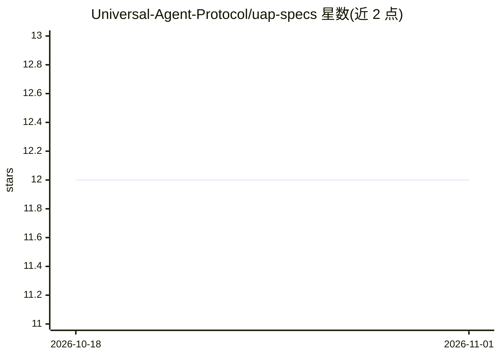

# Universal-Agent-Protocol/uap-specs

⭐ 12 · 推送 2026-02-16 · [GitHub](https://github.com/Universal-Agent-Protocol/uap-specs) · [官网](https://uap-protocol.com) · 组织维护

**多智能体系统互操作协议规范：通信、发现、协调三协议**

以白皮书/规范文档形式定义三个协议：UACP 规范化智能体间消息结构（header/payload、请求-响应/通知/任务委派等交互模式）、UADP 提供去中心化智能体注册与按能力发现（含负载信息）、UACO 提供协商、承诺与群组协调机制。面向构建分布式多智能体系统的开发与设计者，内容为消息 schema、JSON 示例与系统图，属于规范文档而非可运行软件；README 未给出安装方式或参考实现。

## 筛选速览

| 维度 | 判定 | 备注 |
|---|---|---|
| AI 角色 | `ai-ecosystem` | LLM/agent 周边工具 |
| 许可风险 | `none` | — |
| 部署形态 | `None` |  |
| 模型依赖 | — | README 未给出锁定关系 |
| 硬件要求 | — | 无带数字的原话,不猜 |
| 安装摩擦 | `low` | 无编译、无系统依赖或容器化 |
| 成熟度 | — | 结构信号不足 |

## 能力要点

- UACP 定义统一消息头（messageId/authToken/signature 等）与四种消息类型
- UADP 支持去中心化注册与基于能力和负载的智能体发现
- UACO 提供协商（提案/还价/承诺）与冲突解决机制
- 提供任务委派、发现、协商等 JSON 消息示例与系统图

## 适用场景

- 为多智能体系统设计互操作的消息与发现机制时参考该规范
- 实现跨组织的智能体任务委派与协商流程
- 了解分布式智能体协调协议的消息 schema 设计

## 场景标签

`多智能体` · 领域:Agent 开发

## 证据(README 行号)

> L7: In the era of rapidly expanding distributed systems and artificial intelligence, the need for a scalable, flexible, 
> L56: **Purpose:** UACP standardizes the communication between agents, ensuring consistent message formats, interaction p
> L68: **Purpose:** UADP enables agents to discover each other dynamically, facilitating load balancing and scalability.
> L79: **Purpose:** UACO provides mechanisms for agents to coordinate tasks, negotiate terms, and collaborate on complex w

## 星数曲线

2026-10-18 12 → 2026-11-01 12（+0）

---
*卡片 v1 · prompt 1.4 · 生成 2026-11-01 · 置信度 high · 依据 README sha `a5f3e02e6a20` · [字段定义](../../DATASET.md)*
