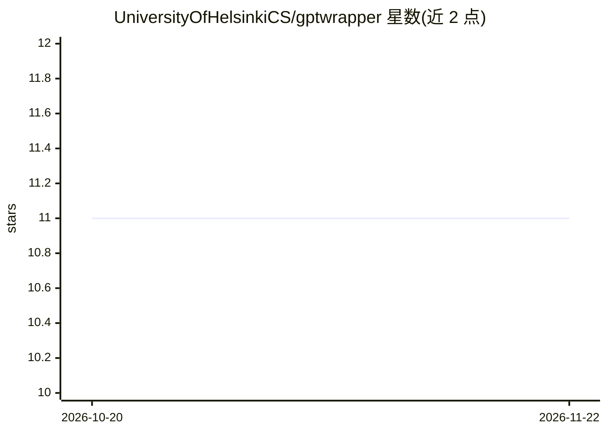

# UniversityOfHelsinkiCS/gptwrapper

⭐ 11 · TypeScript · MIT · 推送 2026-11-19 · [GitHub](https://github.com/UniversityOfHelsinkiCS/gptwrapper) · [官网](https://curre.helsinki.fi/chat) · 组织维护

**赫尔辛基大学师生的教学科研 LLM 聊天应用**

面向赫尔辛基大学教职工和学生的 LLM 聊天服务，用于教学与科研场景。核心机制：基于选课与教职工角色控制访问权限，教师可自定义系统提示词，并通过 RAG 为课程引入自有资料作为回答依据。开发环境通过 npm 与 docker compose 启动，依赖 PostgreSQL、Redis、Ollama（docker 容器）以及外部 Azure 与 S3 服务；服务端暴露 Prometheus 指标，附 Playwright 端到端测试与无障碍支持说明。

## 筛选速览

| 维度 | 判定 | 备注 |
|---|---|---|
| AI 角色 | `ai-native` | 本体是模型或模型工具 |
| 许可风险 | `permissive` | MIT |
| 部署形态 | `self-host` | docker 或自建部署 |
| 模型依赖 | local-ok | 支持本地模型 |
| 硬件要求 | — | 无带数字的原话,不猜 |
| 安装摩擦 | `low` | 无编译、无系统依赖或容器化 |
| 成熟度 | — | 结构信号不足 |

## 能力要点

- 基于选课注册与教职工角色的访问控制
- 教师自定义系统提示词管理
- RAG：教师可为课程上传自有资料作为检索来源
- 暴露 Prometheus 指标，含 BullMQ VLM 队列与 GPU 指标

## 适用场景

- 学生按选课权限使用课程专属的 LLM 聊天
- 教师为课程配置提示词与参考资料
- 大学内部教学场景的受控 AI 问答

## 场景标签

`RAG` `文档问答` · 领域:知识与检索

## 证据(README 行号)

> L3: LLM chat built for University of Helsinki staff and students, for education and research.
> L7: - Access based on enrolments and staff role
> L9: - Retrieval-augmented generation: teachers can bring their own source material for a course

## 星数曲线

2026-10-20 11 → 2026-11-22 11（+0）

---
*卡片 v1 · prompt 1.4 · 生成 2026-11-18 · 置信度 high · 依据 README sha `70a1e8c37a8d` · [字段定义](../../DATASET.md)*
