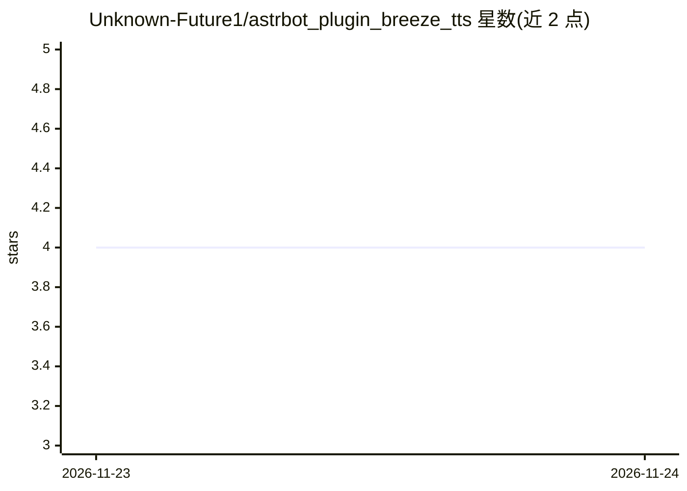

# Unknown-Future1/astrbot_plugin_breeze_tts

⭐ 4 · Python · MIT · 推送 2026-11-18 · [GitHub](https://github.com/Unknown-Future1/astrbot_plugin_breeze_tts) · 个人维护 · 中文 README

**AstrBot 插件：用本地克隆音色让 QQ 机器人发语音**

面向 AstrBot 框架的 TTS 插件，接入本地部署的 Breeze TTS 2 模型服务，使 QQ 聊天机器人能用克隆音色回复语音。核心机制：3~20 秒 WAV 参考音频加逐字转录克隆音色；LLM 分析消息情绪自动生成语气配音指令；内置 WSOLA 语速伸缩与 ±12 半音变调；支持触发概率、屏蔽词、长文本分段并发合成、空闲休眠释放显存与资源预检。依赖已运行的 AstrBot（≥v4.29.3）与本地 Breeze 服务；克隆仅接受 WAV，模型权重为非商用许可。

## 筛选速览

| 维度 | 判定 | 备注 |
|---|---|---|
| AI 角色 | `ai-native` | 本体是模型或模型工具 |
| 许可风险 | `permissive` | MIT |
| 部署形态 | `desktop` | 安装包/桌面程序 |
| 模型依赖 | — | README 未给出锁定关系 |
| 硬件要求 | `gpu-8g` | |
| 安装摩擦 | `low` | 无编译、无系统依赖或容器化 |
| 成熟度 | — | 结构信号不足 |

## 能力要点

- 3~20 秒 WAV 参考音频克隆音色，无需 API Key、完全本地推理
- LLM 分析情绪自动生成语气指令，支持手写指令与三档静态预设
- WSOLA 语速伸缩与 ±12 半音变调（变调不改时长）
- 空闲自动休眠释放显存、冷启动预热、显存不足时降级为纯文字

## 适用场景

- 让 QQ 群里的聊天机器人用自定义音色发语音回复
- 为机器人克隆特定音色并调节语速音调
- 显存有限的本地环境下按需启动 TTS 服务

## 场景标签

`语音合成` · 领域:内容生成

## 证据(README 行号)

> L1: # 🐋 Breeze TTS 克隆语音 — AstrBot 插件
> L13: 不需要在 AstrBot 里配置任何 TTS 服务提供商。只要装好插件、部署 Breeze 模型、把本地 Breeze 服务跑起来、克隆完音色，填上音色 ID 就能用。
> L154: 插件启用后，AI 就拥有 `clone_tts` 工具，会在「用户想听声音」时主动调用：

## 星数曲线

2026-11-23 4 → 2026-11-24 4（+0）

---
*卡片 v1 · prompt 1.4 · 生成 2026-11-23 · 置信度 mid · 依据 README sha `4bd1fce328dd` · [字段定义](../../DATASET.md)*
