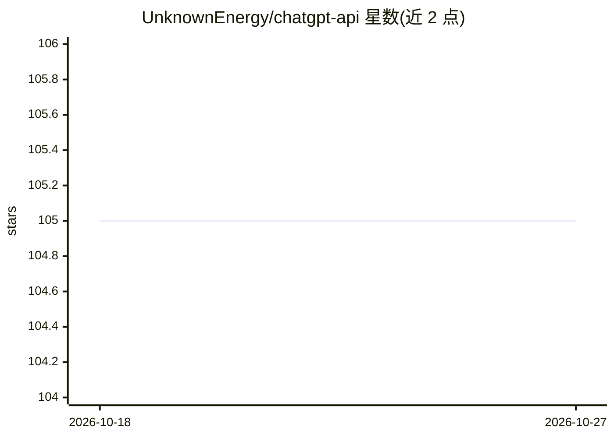

# UnknownEnergy/chatgpt-api

⭐ 105 · TypeScript · MIT · 推送 2026-02-11 · [GitHub](https://github.com/UnknownEnergy/chatgpt-api) · [官网](https://www.chatworm.com) · 个人维护

**网页/移动端 ChatGPT 类对话客户端：直连多家模型 API**

Chatworm 是一个单页应用（SPA），用户通过 Web、Android、Windows 应用直接与多家模型 API 对话，支持 OpenAI、Anthropic、Google Gemini、Deepseek、Alibaba Qwen、xAI Grok。浏览器与模型 API 之间无服务器，应用下载后缓存于浏览器，用户直接与 API 通信。本地开发通过 npm install / npm start 启动（localhost:4200），可用 PWA Builder 打包发布到应用商店。MIT 许可。

## 筛选速览

| 维度 | 判定 | 备注 |
|---|---|---|
| AI 角色 | `ai-native` | 本体是模型或模型工具 |
| 许可风险 | `permissive` | MIT |
| 部署形态 | `library` | 以包/库形式分发 |
| 模型依赖 | locked-api |  |
| 硬件要求 | — | 无带数字的原话,不猜 |
| 安装摩擦 | `low` | 无编译、无系统依赖或容器化 |
| 成熟度 | — | 结构信号不足 |

## 能力要点

- 浏览器直连模型 API，中间无服务器
- 支持 OpenAI/Anthropic/Gemini/Deepseek/Qwen/Grok 等多家模型
- 提供 Web、Android、Windows 多端应用

## 适用场景

- 在多平台上用同一个客户端对话多家模型 API
- 自建无服务器的 ChatGPT 风格对话前端
- 通过 PWA Builder 打包发布到应用商店

## 场景标签

`聊天机器人` · 领域:对话与助手

## 证据(README 行号)

> L19: 🤖 OpenAI
> L26: This is a single page application there is no server between your browser and the model APIs. The app is just downl

## 星数曲线

2026-10-18 105 → 2026-10-27 105（+0）

---
*卡片 v1 · prompt 1.4 · 生成 2026-10-23 · 置信度 high · 依据 README sha `fd4ccd7f5364` · [字段定义](../../DATASET.md)*
