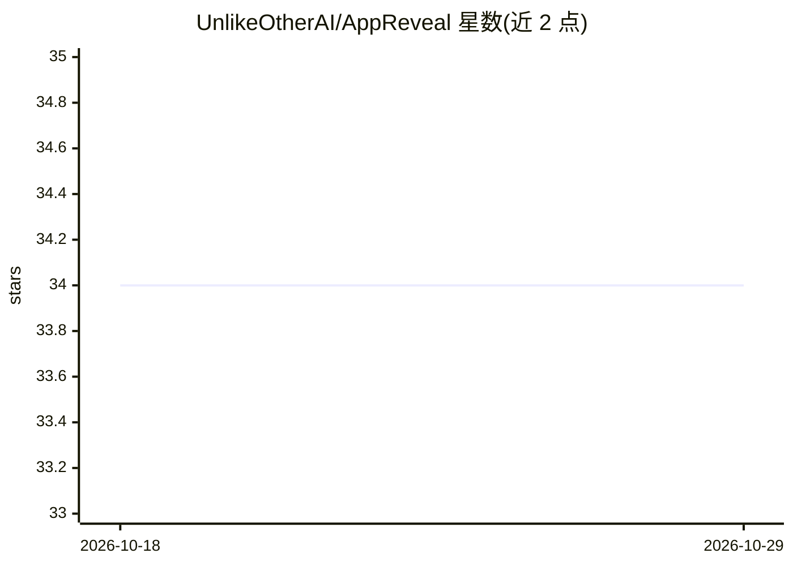

# UnlikeOtherAI/AppReveal

⭐ 34 · Swift · MIT · 推送 2026-10-02 · [GitHub](https://github.com/UnlikeOtherAI/AppReveal) · 组织维护

**给 LLM agent 控制原生应用的调试期 MCP server**

嵌入 iOS/macOS/Android/Flutter/React Native/Windows 应用的调试专用 MCP server：应用调用 AppReveal.start() 后在本地网络启动 HTTP 服务并经 mDNS 广播，外部 agent 通过 MCP 工具读取屏幕/元素/视图树、应用状态、导航栈、网络流量、日志与 WebView DOM，并执行点击、输入、滚动、批量操作等控制。各平台在 release 构建中零代码路径，MCP 请求需会话令牌，仅限本地网络/回环。提供 npm 安装的 CLI 用于服务发现与 MCP 请求。

## 筛选速览

| 维度 | 判定 | 备注 |
|---|---|---|
| AI 角色 | `ai-ecosystem` | LLM/agent 周边工具 |
| 许可风险 | `permissive` | MIT |
| 部署形态 | `library` | 以包/库形式分发 |
| 模型依赖 | — | README 未给出锁定关系 |
| 硬件要求 | — | 无带数字的原话,不猜 |
| 安装摩擦 | `low` | 无编译、无系统依赖或容器化 |
| 成熟度 | — | 结构信号不足 |

## 能力要点

- 跨 6 类平台共享同一 MCP 工具面（UI/状态/诊断/WebView DOM/批量操作）
- mDNS 广播 _appreveal._tcp，agent 自动发现或直连 localhost
- release 构建零生产足迹（#if DEBUG / debugImplementation / __DEV__ 守卫）
- token 高效的 DOM 查询工具（get_dom_summary/get_dom_text 等）

## 适用场景

- 让 LLM agent 像 Playwright 一样驱动我的原生调试构建做 UI 自动化
- 开发调试时读取应用状态、网络流量与日志做问题排查
- agent 测试混合 WebView 应用时直接查询和操作页面 DOM

## 场景标签

`GUI 自动化` · 领域:效率与自动化

## 证据(README 行号)

> L7: Debug-only in-app MCP server for iOS, macOS, Android, Flutter, React Native, and Windows app stacks. Lets LLM agents
> L20: 1. App calls `AppReveal.start()` in a debug build
> L274: There is now a dedicated AppReveal CLI in CLI/README.md for discovering `_appreveal._tcp` services, listing availa

## 星数曲线

2026-10-18 34 → 2026-10-29 34（+0）

---
*卡片 v1 · prompt 1.4 · 生成 2026-10-25 · 置信度 high · 依据 README sha `bbe0bfbe30fd` · [字段定义](../../DATASET.md)*
