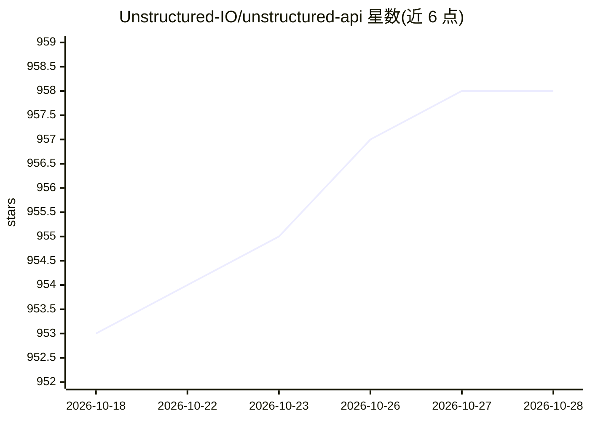

# Unstructured-IO/unstructured-api

⭐ 959 · Python · Apache-2.0 · 推送 2026-10-20 · [GitHub](https://github.com/Unstructured-IO/unstructured-api) · 组织维护

**文档分区 REST API：上传文件返回结构化文档元素**

基于开源 unstructured 库的自托管 REST API：检测上传文件类型、选择对应分区器，将文档解析为元素并以 JSON 或 CSV 返回。支持 PDF/图像的 auto/fast/hi_res/ocr_only 策略、OCR 语言选择、by_title 分块、多文件请求。面向需要自行运行 Partition Endpoint 的开发者（另有 Unstructured 托管版）。提供 Docker 镜像（amd64/arm64）与 make 本地运行方式；系统依赖取决于所处理的文档类型。

## 筛选速览

| 维度 | 判定 | 备注 |
|---|---|---|
| AI 角色 | `ai-native` | 本体是模型或模型工具 |
| 许可风险 | `permissive` | Apache-2.0 |
| 部署形态 | `self-host` | docker 或自建部署 |
| 模型依赖 | — | README 未给出锁定关系 |
| 硬件要求 | — | 无带数字的原话,不猜 |
| 安装摩擦 | `low` | 无编译、无系统依赖或容器化 |
| 成熟度 | — | 结构信号不足 |

## 能力要点

- 文件类型自动检测并选择对应分区器
- PDF/图像四种策略（auto/fast/hi_res/ocr_only）与 OCR 语言选择
- by_title 分块（含重叠控制）、JSON/CSV/multipart 响应
- amd64/arm64 Docker 镜像与 API key、内存下限等服务器配置

## 适用场景

- 在私有环境运行文档解析服务，供下游 RAG 管线调用
- 批量把 PDF、邮件等文档转为结构化元素或 CSV
- 通过 hi_res 策略做版面感知的文档解析

## 场景标签

`文档解析` · 领域:知识与检索

## 证据(README 行号)

> L5: A self-hosted REST API for partitioning documents with the
> L7: detects the uploaded file type, selects the corresponding partitioner, and returns document
> L19: - PDF and image strategies: `auto`, `fast`, `hi_res`, and `ocr_only`.

## 星数曲线

2026-10-18 953 → 2026-10-28 958（+5）

---
*卡片 v1 · prompt 1.4 · 生成 2026-10-21 · 置信度 high · 依据 README sha `2e278216c3d0` · [字段定义](../../DATASET.md)*
