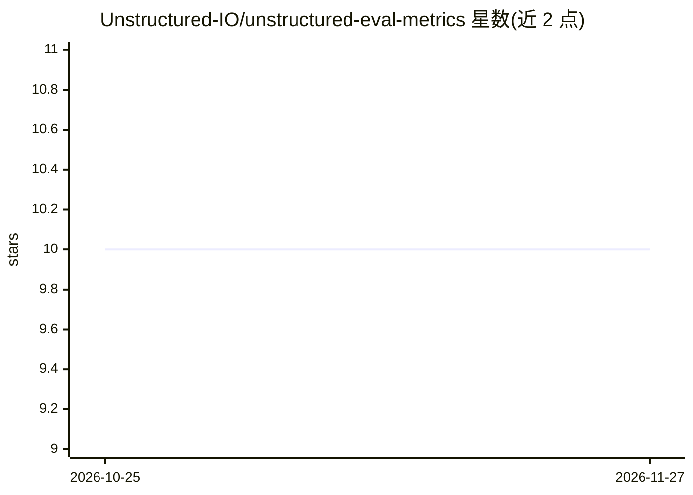

# Unstructured-IO/unstructured-eval-metrics

⭐ 10 · Python · Apache-2.0 · 推送 2025-12-02 · [GitHub](https://github.com/Unstructured-IO/unstructured-eval-metrics) · 组织维护

**文档解析系统评测框架：度量生成式解析输出的结构与内容质量**

SCORE（Structural and Content Robust Evaluation）框架的实现仓库，用于评测基于视觉语言模型的文档解析系统输出质量。提供带标注 ground truth 的示例文档、多维度指标计算脚本与基准测试流程，覆盖调整编辑距离、token 级遗漏/幻觉分离、格式无关的表格评测与层级一致性。数据管道用 JSON 配置，输出文档级与聚合级 CSV 报告；Apache-2.0 许可，内部评测集大部分为专有文档不对外分发。

## 筛选速览

| 维度 | 判定 | 备注 |
|---|---|---|
| AI 角色 | `ai-ecosystem` | LLM/agent 周边工具 |
| 许可风险 | `permissive` | Apache-2.0 |
| 部署形态 | `None` |  |
| 模型依赖 | — | README 未给出锁定关系 |
| 硬件要求 | — | 无带数字的原话,不猜 |
| 安装摩擦 | `medium` | 含编译或系统依赖之一 |
| 成熟度 | — | 结构信号不足 |

## 能力要点

- 四维评测：调整编辑距离、token 级诊断、表格评测、层级一致性
- token 级指标区分内容遗漏与幻觉
- 格式无关表格表示，支持 HTML/JSON 等输出映射为元组比较
- 带标注示例数据与自建 ground truth 的标注约定

## 适用场景

- 为自有文档解析系统建立基准测试流程
- 按同一标注约定标记自己的文档数据集
- 对比不同解析系统在幻觉、遗漏、结构差异上的表现
- 跟踪解析质量随迭代的改进情况

## 场景标签

`模型评测` · 领域:评测与运维

## 证据(README 行号)

> L3: A comprehensive evaluation framework designed to benchmark the performance of document
> L31: * A framework for benchmarking document parsing systems
> L144: 4. Run the evaluation scripts to calculate metrics

## 星数曲线

2026-10-25 10 → 2026-11-27 10（+0）

---
*卡片 v1 · prompt 1.4 · 生成 2026-11-20 · 置信度 high · 依据 README sha `5baf4ed28194` · [字段定义](../../DATASET.md)*
