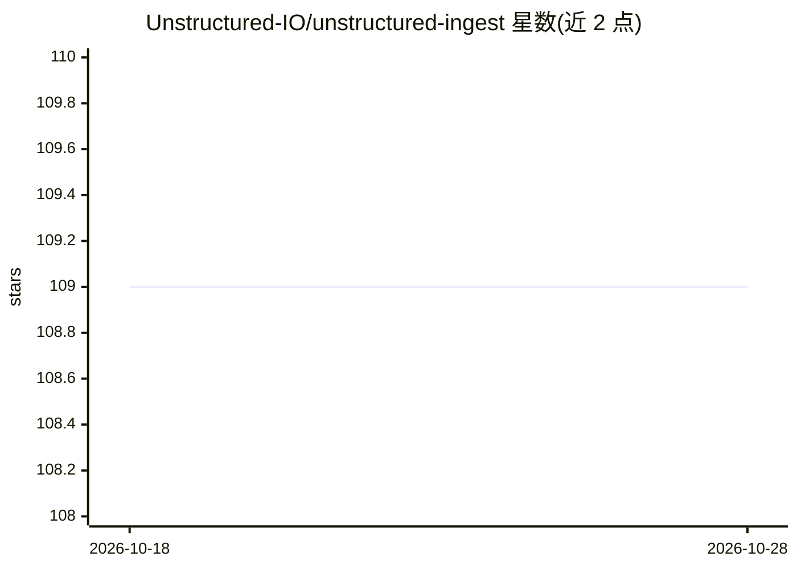

# Unstructured-IO/unstructured-ingest

⭐ 109 · HTML · Apache-2.0 · 推送 2026-10-27 · [GitHub](https://github.com/Unstructured-IO/unstructured-ingest) · 组织维护

**文档摄取工具：将多种来源数据转入 Unstructured 处理管线**

Unstructured-IO 维护的摄取（ingest）工具，用于从各类数据源读取原始文档并送入 Unstructured 文档处理流程（解析、分块等），服务 RAG 与 LLM 应用前的数据准备。README 仅指向官方文档获取细节，未在本页列出具体连接器、安装命令或使用示例。以 Python 生态形式提供，需查阅文档确认具体能力。

## 筛选速览

| 维度 | 判定 | 备注 |
|---|---|---|
| AI 角色 | `ai-ecosystem` | LLM/agent 周边工具 |
| 许可风险 | `permissive` | Apache-2.0 |
| 部署形态 | `None` |  |
| 模型依赖 | — | README 未给出锁定关系 |
| 硬件要求 | — | 无带数字的原话,不猜 |
| 安装摩擦 | `low` | 无编译、无系统依赖或容器化 |
| 成熟度 | — | 结构信号不足 |

## 能力要点

- 从多种数据源摄取文档进入 Unstructured 处理管线
- 细节见 Unstructured 官方文档

## 适用场景

- 为 RAG 系统批量准备并分块原始文档
- 从不同存储源摄取数据做预处理

## 场景标签

`文档解析` · 领域:知识与检索

## 证据(README 行号)

> L1: # Unstructured Ingest
> L3: For details, see the Unstructured Ingest overview in the Unstructured documentation.

## 星数曲线

2026-10-18 109 → 2026-10-28 109（+0）

---
*卡片 v1 · prompt 1.4 · 生成 2026-10-23 · 置信度 low · 依据 README sha `9c297cea1616` · [字段定义](../../DATASET.md)*
