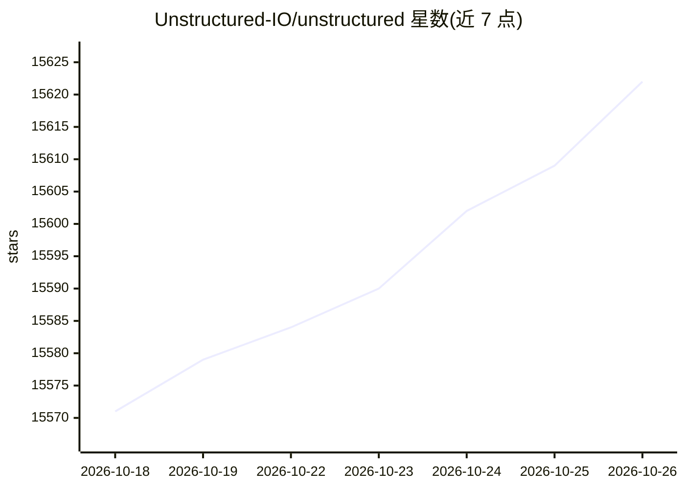

# Unstructured-IO/unstructured

⭐ 15,622 · HTML · Apache-2.0 · 推送 2026-10-24 · [GitHub](https://github.com/Unstructured-IO/unstructured) · [官网](https://www.unstructured.io/) · 组织维护

**面向 LLM 开发者的文档解析 ETL 库：把文档转为结构化数据**

提供开源组件用于摄取和预处理图像与文本文档（PDF、HTML、Word 等），核心是 partition 函数，自动检测文件类型并路由到对应的分区函数，输出结构化元素。安装方式包括 PyPI 安装（按文档类型选择 extras）、Docker 容器运行及本地开发（uv 管理依赖）。README 注明开源库永久免费，但官方推荐更高精度的 Transform v2 API（商业产品），并默认发送轻量遥测，可通过环境变量关闭。

## 筛选速览

| 维度 | 判定 | 备注 |
|---|---|---|
| AI 角色 | `ai-ecosystem` | LLM/agent 周边工具 |
| 许可风险 | `permissive` | Apache-2.0 |
| 部署形态 | `self-host` | docker 或自建部署 |
| 模型依赖 | — | README 未给出锁定关系 |
| 硬件要求 | — | 无带数字的原话,不猜 |
| 安装摩擦 | `low` | 无编译、无系统依赖或容器化 |
| 成熟度 | — | 结构信号不足 |

## 动量与使用信号

- 维护:`active` — 距上次 push 1.5 天,年发版 55,163 位贡献者
- 涨星:近 1 天 **+1**(自 20261016 起算)
- 安装:pypi 包 `unstructured` 月下载无数据

## 能力要点

- partition 函数自动检测文件类型并路由到对应分区函数
- 按文档类型提供 pip extras 安装（如 unstructured[docx,pptx]）
- 提供多平台 Docker 镜像（x86_64 与 Apple silicon）
- 默认遥测可通过 DO_NOT_TRACK 或 SCARF_NO_ANALYTICS 关闭

## 适用场景

- 把 PDF/HTML/Word 等文档解析为结构化输出供 LLM 使用
- 用 Docker 容器快速搭建文档预处理环境
- 批量摄取不同格式文档并统一为结构化元素

## 场景标签

`文档解析` · 领域:知识与检索

## 证据(README 行号)

> L29: The `unstructured` library provides open-source components for ingesting and pre-processing images and text documen
> L100: - Install the Python SDK to support all document types with `pip install "unstructured[all-docs]"`
> L238: Unstructured sends lightweight analytics to `GET https://packages.unstructured.io/python-telemetry` by default: on

## 星数曲线

2026-10-18 15,571 → 2026-10-26 15,622（+51）

---
*卡片 v1 · prompt 1.4 · 生成 2026-10-18 · 置信度 high · 依据 README sha `b392a98a3958` · [字段定义](../../DATASET.md)*
