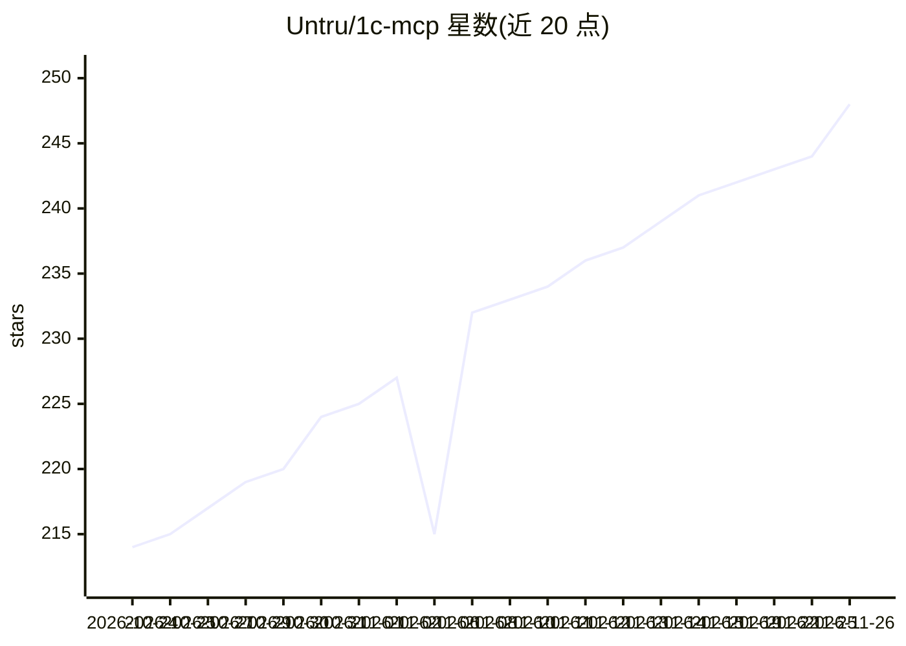

# Untru/1c-mcp

⭐ 248 · Python · 推送 2026-11-23 · [GitHub](https://github.com/Untru/1c-mcp) · 个人维护

**1C:企业生态的 MCP 服务器与 skills 目录清单**

面向 1С:Предприятие 生态的策展目录，收录将 AI 助手（Claude Code、Codex、Cursor、VS Code Copilot 等）接入 1C 的 MCP 服务器、插件与 skills 集。按 IDE 集成、活数据库与框架、元数据与代码分析等类别组织条目，每条标注技术栈、MCP 传输方式、平台要求与维护状态；附按 GitHub 星数排序的自动更新榜单（每周一重建）与按任务场景的入门导航表，接受 issue/PR 补充条目。

## 筛选速览

| 维度 | 判定 | 备注 |
|---|---|---|
| AI 角色 | `ai-knowledge` | 知识聚合/清单类 |
| 许可风险 | `none` | — |
| 部署形态 | `self-host` | docker 或自建部署 |
| 模型依赖 | — | README 未给出锁定关系 |
| 硬件要求 | — | 无带数字的原话,不猜 |
| 安装摩擦 | `low` | 无编译、无系统依赖或容器化 |
| 成熟度 | — | 结构信号不足 |

## 能力要点

- 按类别组织的 MCP 服务器/插件/skills 目录，标注技术栈、传输与状态（✅/🚧/🔬/📦）
- 按星数排序的榜单每周一由 workflow 自动重建
- 提供按任务场景（EDT 开发、连接活数据库、代码分析等）的选型导航表

## 适用场景

- 为 1C 项目找能把 AI 代理接入 EDT 或 VS Code/Cursor 的 MCP 工具
- 想从 1C 数据库快速搭建 MCP 服务器的开发者查方案
- 需要给代理配置代码分析、测试运行或平台语法参考工具时按场景选型

## 场景标签

`精选清单` · 领域:学习与行业

## 证据(README 行号)

> L1: # Awesome 1C MCP Servers
> L6: Каталог MCP-серверов, плагинов и наборов skills, которые подключают AI-ассистентов (Claude Code, Codex, Cursor, VS C
> L8: **Зачем это всё.** Сама по себе нейросеть про вашу 1С ничего не знает: не видит метаданные, путает методы платформы,

## 星数曲线

2026-10-24 214 → 2026-11-26 248（+34）

---
*卡片 v1 · prompt 1.4 · 生成 2026-11-25 · 置信度 mid · 依据 README sha `0b3b2c8971b9` · [字段定义](../../DATASET.md)*
